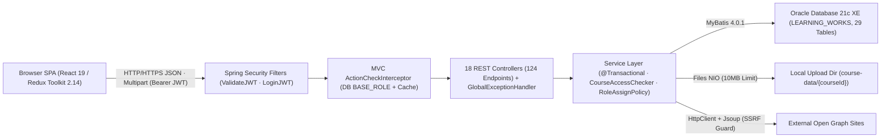
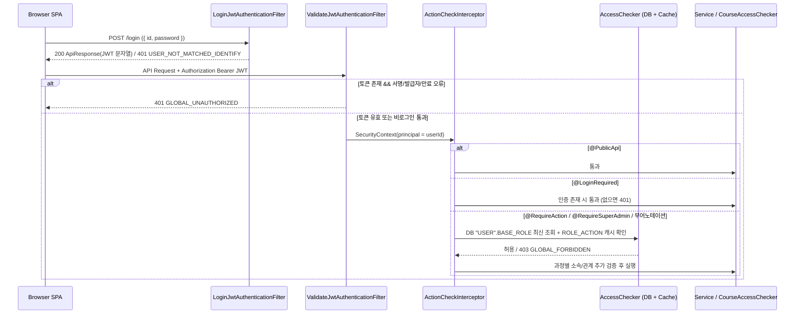
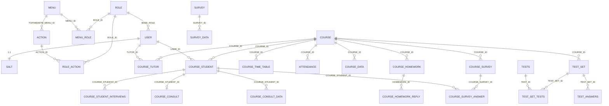

# LearningWorks (28th LMS) 통합 개발 명세서

> **기준 일자**: 2026-11-19  
> **분석 기준 브랜치**: `origin/dev` (`81af246`, PR #103 강사 대시보드 · #104 버그 수정 · #105 공용 과정 단위 권한 확인 · #106 출석률 기준 변경 · #107 과정 관리자 판단을 권한 코드로 · #108 다크 모드 보완 · #109 관리자/슈퍼관리자 대시보드 · #110 Swagger 머지 완료)  
> **대상 범위**: Backend(`com.learningworks.*`, `Java 21` / `Spring Boot 4.0.0` / `MyBatis 4.0.1`) + Frontend(`React 19.3.1` / `Vite 8.3.5`) + Oracle Database 21c XE (`21.3.0.0.0`)

---

## 1. 시스템 아키텍처 및 기술 스택

**LearningWorks**는 React SPA가 JWT를 실어 Spring Boot REST API를 호출하고, REST 컨트롤러·서비스 계층이 MyBatis를 통해 공유 Oracle 21c XE 데이터베이스에 접근하는 3계층 구조입니다.  
모든 API 응답은 `ApiResponse<T>` JSON(첨부파일 다운로드 1건 제외)으로 통일되며, 업무·검증·보안 예외는 전역 예외 처리기(`GlobalExceptionHandler`) 및 `/error` 컨트롤러가 일관된 JSON 오류 포맷으로 변환합니다.

### 1.1 전체 시스템 구성도



### 1.2 기술 스택 (실제 `pom.xml` · `package.json` · 설정 파일 기준)

| 계층 | 기술 / 라이브러리 | 버전 | 실제 사용 및 설정 내역 |
|---|---|---|---|
| **Backend Runtime** | Java (`java.version`) | `21` | 컴파일 · 실행 타깃 JDK 21 |
| **Backend Core** | `spring-boot-starter-parent` | `4.0.0` | Spring Boot 4 / Spring Framework 7 / Tomcat(개발 `spring-boot:run`, `provided`) / Jackson 3(`tools.jackson.*`) |
| **Security & Auth** | `spring-boot-starter-security`, `jjwt` (`api`/`impl`/`jackson`) | `0.13.0` | Stateless JWT 필터 인증, HMAC-SHA 서명(7일) |
| **Persistence** | `mybatis-spring-boot-starter`, `ojdbc17` | `4.0.1` / `23.26.3` | `mapUnderscoreToCamelCase=true`, `jdbcTypeForNull=NULL` |
| **API Docs** | `springdoc-openapi-starter-webmvc-ui` | `3.0.3` | Swagger UI(`/swagger-ui.html`) · OpenAPI JSON(`/v3/api-docs`), `OpenApiConfig`로 권한 어노테이션·`POST /login` 자동 문서화 (PR #110) |
| **Utils / Parsing** | Apache POI(`poi`, `poi-ooxml`, `poi-scratchpad`), `jsoup`, `gson`, `lombok` | `5.5.1` / `1.21.1` / Boot 관리 | 엑셀 시간표 파싱(`POI`), **에디터 HTML XSS 방어 및 링크 미리보기 OG 파싱(`jsoup`)**, JSON/VO 보조 |
| **Database** | Oracle Database 21c Express Edition | `21.3.0.0.0` | 스키마 `LEARNING_WORKS`, 사용 29개 테이블 + `SEQ_*_PK` 시퀀스 |
| **Frontend Core** | `react`, `react-dom`, `vite`, `@vitejs/plugin-react` | `19.3.1` / `8.3.5` / `6.1.2` | SPA 빌드 및 개발 서버 (기본 포트 `5173`) |
| **Routing & State** | `react-router-dom`, `@reduxjs/toolkit`, `react-redux`, `redux` | `7.18.5` / `2.14.0` / `9.3.1` | Data Router(`createBrowserRouter`), 7개 전역 슬라이스 |
| **UI / Chart / Font** | `apexcharts`, `react-select`, `pretendard` | `8.7.0` / `5.10.2` / `1.3.9` | 성적 막대 차트, 커스텀 셀렉트, 웹폰트 *(`@fullcalendar/*` `6.1~7.1`은 의존성만 존재하며 `src/` 미사용)* |
| **Lint** | `eslint`, `@eslint/js`, `eslint-plugin-react-hooks`, `react-refresh` | `10.13.0` | Flat config (`archive/` 직접 `import` 금지 규칙 포함) |

### 1.3 저장소 폴더 · 패키지 구조

```text
28th-lms-repo/
├── backend/
│   ├── pom.xml
│   ├── docs/                                    # 권한(access-control-guide) · 응답 · 메뉴 설계 문서
│   └── src/main/
│       ├── java/com/learningworks/
│       │   ├── common/                          # action(권한/캐시/Declarer), config(OpenApiConfig), exceptions(ErrorCode/Handler), utils, vo
│       │   ├── security/                        # SecurityConfig, JWT 필터 2종, LoginUser, Handlers
│       │   ├── access/                          # 권한 코드(ACTION) 메뉴 매핑 관리 (※ 로그인 이력 모듈 아님)
│       │   ├── accessrole/, code/, dashboard/, member/, menu/, role/
│       │   ├── attendance/, counsel/, course/, courseData/, exam/, interview/, score/, survey/, timetable/
│       │   │   # ※ course/service/AttendanceSummaries.java (PR #109 공용 출석 요약 분리)
│       │   └── category/                        # 미구현 빈 스캐폴딩(.gitkeep 만 존재)
│       └── resources/
│           ├── application.yml                  # DB, multipart(10MB), JWT(7d), access-check, attendance 시각 기준
│           ├── config/mybatis-config.xml
│           └── com/learningworks/**/dao/mapper/*DaoMapper.xml
└── frontend/
    ├── package.json, eslint.config.js, vite.config.js, index.html
    ├── docs/                                    # api-client, page, permission, ui-style, design/dashboard-design.md
    └── src/
        ├── api/                                 # api/common/apiClient.js + dashboardApi.js(PR #109) + 도메인 API 모듈
        ├── hooks/                               # usePermission.js, useBreadcrumbs.js, useCourseRelation.js(PR #105)
        ├── layout/                              # MainLayout.jsx, MenuGuard.jsx
        ├── router/                              # MainRouterProvider.jsx, routeUtils.js, breadcrumbUtils.js
        ├── store/                               # StoreProvider.jsx + 7개 Redux slice(login, permission, menu, courses, test, question, survey)
        ├── styles/                              # 공통 UI CSS + index.css(디자인 토큰 · 다크 모드)
        ├── theme/                               # colorScheme.js (light/dark + bright island)
        └── components/                          # main(Main · TutorDashboard · AdminDashboard · hooks/parts), login, menu, my, admin, common, sample, archive
```

- **백엔드 실제 동작 도메인 패키지 18개**: `access`, `accessrole`, `attendance`, `code`, `common`, `counsel`, `course`, `courseData`, `dashboard`(PR #109), `exam`, `interview`, `member`, `menu`, `role`, `score`, `security`, `survey`, `timetable` *(빈 스캐폴딩 `category` 제외)*.

---

## 2. 인증 · 인가 · 과정 단위 접근 아키텍처

### 2.1 로그인 · JWT · 인가 파이프라인



- **로그인 · 토큰**: `POST /login` 성공 시 `iss=learningworks`, `sub`=회원 ID, `roles=[BASE_ROLE]`, HMAC 서명, 유효기간 7일 JWT 문자열을 `body`로 반환합니다. 토큰 내부 `roles`는 서버 권한 판단에 쓰지 않고 요청마다 **DB `BASE_ROLE`**을 조회합니다.
- **로그인 잠금**: 비밀번호 불일치 연속 5회 시 30분 차단(`PWD_FAIL_CNT`, `LOGIN_BLOCK_DATE`, `LoginUser.MAX_LOGIN_FAIL_COUNT=5`, `LOCK_MINUTES=30`). 30분 경과 후 실패 시 1부터 다시 카운트하며 관리자 비밀번호 초기화 시 잠금도 해제됩니다. 미존재 ID/잠금/탈퇴 모두 `401 USER_NOT_MATCHED_IDENTIFY`를 반환합니다.
- **본인 확인**: 내 정보·문제은행·상담 상세 진입 시 `POST /members/me/password/verify`로 재확인하며 로그인 실패 카운트를 공유합니다(불일치 `400`, 잠금 `403 USER_BLOCKED_LOGIN`).
- **로그아웃 · 이력**: 별도 로그아웃 API 없이 클라이언트 상태/토큰을 비우며, `ACCESS` 테이블 로그인 이력은 아직 기록하지 않습니다.
- **Spring Security vs 인터셉터**: `SecurityConfig`는 `anyRequest().permitAll()`, CSRF 비활성, Stateless 세션, CORS 전체 허용(`*` + `allowCredentials(true)`)으로 설정되어 있으며, 실제 URI 권한 차단은 `ActionCheckInterceptor`가 담당합니다. 단, `ActionCheckWebConfig`는 PR #110 Swagger UI·명세 경로(`/swagger-ui.html`, `/swagger-ui/**`, `/v3/api-docs`, `/v3/api-docs/**`)를 인터셉터에서 제외합니다.

### 2.2 API 권한 검사 · 캐시 · 계층 정책

| 어노테이션 | 엔드포인트 수 (`origin/dev`) | 통과 조건 |
|---|---|---|
| `@RequireAction(domain, action, description)` | **105개** (고유 코드 **72종** + 선언형 `DeclaredActionCode` **2종** = 총 **74종**) | DB `BASE_ROLE`에 `{DOMAIN}_{ACTION}` 매핑(`ROLE_ACTION`) 존재. `ROLE_SUPER_ADMIN` 항상 통과 |
| `@LoginRequired` | **10개** | 로그인 인증만 필수 (`401 GLOBAL_UNAUTHORIZED`) |
| `@RequireSuperAdmin` | **8개** | `ROLE_SUPER_ADMIN` 전용 |
| `@PublicApi` | **1개** | 비로그인 포함 전체 허용 (`/error`) |
| 어노테이션 없음 | **0개** | Fail-closed 기본값(`default-super-admin: true`)으로 `SUPER_ADMIN` 전용 |
| **합계** | **124개 메서드** (+ 필터 `POST /login` = **총 125 API**) | 컨트롤러 **18개** 전체 적용 완료 |

- **`ActionCodeRegistry`**: 기동 시 `@RequireAction` 전체를 수집해 정규식(`^[A-Z0-9]+(_[A-Z0-9]+)*$`), 40자 제한, `description` 일관성, 단일 어노테이션 준수를 검증하며 위반 시 부팅을 중단합니다.
- **선언형 권한 코드 (`ActionCodeDeclarer`, PR #107)**: API에 붙지 않고 서비스 안에서 판단하는 코드(현재 `COURSE_ALL_READ` · `COURSE_ALL_MANAGE`)는 `ActionCodeDeclarer`를 구현한 빈에서 `DeclaredActionCode`로 선언하며, 등록부가 같은 규칙으로 함께 수집해 접근 관리 드롭다운에 노출합니다. 판단은 `AccessChecker.hasAction(userId, code)`(SUPER_ADMIN은 항상 true)로 하고, 새 코드는 서버 배포 전에는 화면에서 등록할 수 없으므로 필요하면 SQL로 미리 넣습니다. 배포 후에는 최고 관리자 대시보드의 시스템 점검(`GET /dashboard/system`, PR #109)에서 미등록 · 미부여 · 미사용 코드를 확인할 수 있습니다.
- **`AccessChecker`**: `ConcurrentHashMap<roleId, Set<actionCode>>` + `cacheVersion`으로 동시성 경쟁을 막고, 권한 저장(`/access-role/save`) · 역할 삭제(`DELETE /roles/{roleId}`) 커밋 후(`afterCommit`) `evictRole`로 캐시를 비웁니다. *(단일 JVM 캐시 전제)*
- **`RoleAssignPolicy`**: `ROLE.ROLE_RANK`(작을수록 상위)로 회원 생성·수정·삭제·역할 변경·일괄 이동·목록 조회 범위를 강제합니다.
- **`MenuGuard` & `usePermission` & `useCourseRelation`**: 메뉴 접근(`MENU_ROLE`)은 API 보안과 분리되어 있으며, 새 화면은 메뉴 권한·API 권한·버튼 `can()` 3박자가 일치해야 열립니다. PR #105에서 `useCourseRelation()`이 추가되어 시험 응시·설문 응답 UI가 해당 과정의 `STUDENT`에게만 열립니다.

### 2.3 과정 단위 접근 제어 (`CourseAccessChecker`, PR #105 도입)

권한 코드(`@RequireAction`) 외에 **"해당 과정의 강사/수강생/관리자인가"**를 확인하는 기준입니다.

- **관계 판정 순서 (`relationOf(courseId)`)**: **`TUTOR`(`COURSE_TUTOR`) → `ADMIN`(과정 미등록 + `COURSE_ALL_READ`) → `STUDENT`(`COURSE_STUDENT`)** (`COURSE_ALL_READ` 보유자가 수강생으로 등록돼 있어도 조회 범위가 넓은 `ADMIN` 우선, 강사이면서 수강생 등록은 등록 시 `409 COURSE_TUTOR_STUDENT_CONFLICT`로 차단).
- **관리 기능 기준 (`requireTutorOrAdmin`)**: 이 과정의 강사 또는 `COURSE_ALL_MANAGE` 보유자만 통과하고, `COURSE_ALL_READ`만 있는 조회 전용 사용자는 `403`입니다. 두 코드는 PR #107에서 역할 ID(`ROLE_SUPER_ADMIN` · `ROLE_ADMIN`) 하드코딩을 대신해 도입되었습니다.
- **모듈별 적용 현황**:

| 적용 구분 | 대상 기능 | 서비스 검증 기준 |
|---|---|---|
| **공용 `CourseAccessChecker` 적용** | 과정 상세·수강생 목록, 과제 등록/수정/삭제/목록/상세/댓글, **수강생 추가**, **시험 출제/공개/삭제/정답포함조회/채점(`requireTutorOrAdmin`), 시험 응시/제출(`requireStudent`), 시험 목록(`requireMember`)**, **면접(목록 본인필터/등록 `requireTutorOrAdmin`)**, **상담 전체(`requireTutorOrAdmin`)** | 과정 관계 기반 엄격 검증 완료 |
| **개별 검증 구현** | 과정 목록(`COURSE_ALL_READ`/소속 분기), 출석률 요약/오늘 출석(`isCourseStudent`), 출석 체크/오늘 내 출결(`selectCourseStudentId`), 과정 성적(`COURSE_ALL_READ`/담당 강사), 내 성적(수강생), 설문 응답(`selectCourseStudentId`) | 개별 DAO 조회로 구현됨 *(PR #107부터 관리자 판단은 `COURSE_ALL_READ` · `COURSE_ALL_MANAGE`로 통일, 과제 댓글 등록만 `ROLE_SUPER_ADMIN` 예외)* |
| **과정 소속 확인 미적용 (보완 필요)** | **설문 결과·개별 답변 조회(타 과정 학생 `selectCourseStudentId` null 분기 IDOR)**, **교육 자료 CRUD/파일 업로드·다운로드**, **시간표 전체/일별/업로드**, **과정 수정/삭제**, **설문 배포/삭제/통계** | `@RequireAction` 권한 코드만 확인 |

---

## 3. 공통 응답 · 예외 · 페이징 · 보안 유틸

### 3.1 `ApiResponse<T>` 및 `GlobalExceptionHandler`
- `ApiResponseStatusAdvice`가 `body.getHttpStatusCode()`와 실제 HTTP 응답 코드를 동기화하며, `@JsonInclude(NON_NULL)`로 null 필드를 제외합니다.
  ```json
  { "httpStatusCode": 403, "httpStatusMessage": "Forbidden", "errorCode": "COURSE_NOT_AUTHORIZED", "error": "해당 강의에 대한 권한이 없습니다." }
  ```
- 필드: `httpStatusCode`, `httpStatusMessage`, `body`, `errorCode`, `error`, `paginate`, `search`, `validations`.

### 3.2 `ErrorCode` 전체 분포 (**총 94개 상수**, PR #105 +1)

| HTTP 상태 | 상수 개수 | 주요 대표 코드 |
|---|---|---|
| `400 BAD_REQUEST` | 23 | `GLOBAL_BAD_REQUEST`, `GLOBAL_INVALID_PARAMETER`, `ATTENDANCE_NOT_CLASS_DAY`, `STUDENT_NOT_IN_COURSE` |
| `401 UNAUTHORIZED` | 3 | `GLOBAL_UNAUTHORIZED`, `USER_NOT_MATCHED_IDENTIFY`, `USER_FAILURE_LOGIN`(미사용) |
| `403 FORBIDDEN` | 6 | `GLOBAL_FORBIDDEN`, `USER_BLOCKED_LOGIN`, `COURSE_NOT_AUTHORIZED`, `ROLE_TARGET_FORBIDDEN` |
| `404 NOT_FOUND` | 15 | `GLOBAL_NOT_FOUND_URL`, `USER_NOT_EXISTS`, `COURSE_NOT_EXISTS`, `EXAM_NOT_EXISTS` |
| `405 METHOD_NOT_ALLOWED` | 1 | `GLOBAL_METHOD_NOT_ALLOWED` |
| `409 CONFLICT` | **21** | `GLOBAL_DUPLICATED`, **`COURSE_TUTOR_STUDENT_CONFLICT` (신규)**, `USER_USED`, `ROLE_IN_USE`, `MENU_OUTDATED`, `ATTENDANCE_ALREADY_CHECKED` |
| `413 CONTENT_TOO_LARGE` | 1 | `FILES_TOO_LARGE` |
| `415 UNSUPPORTED_MEDIA_TYPE` | 1 | `GLOBAL_UNSUPPORTED_MEDIA_TYPE` |
| `500 INTERNAL_SERVER_ERROR` | 22 | `GLOBAL_SYSTEM_ERROR`, `FILES_SYSTEM_ERROR` |
| `502 BAD_GATEWAY` | 1 | `LINK_PREVIEW_FAILURE` |

### 3.3 페이징 · 비밀번호 해시 · PK 규칙
- **페이징**: 일반 목록(`Member` 등)은 `PaginationVO`(`pageNo` 0부터, `listSize` 10) + `CommonDaoMapper.xml` Oracle 이중 `ROWNUM` 서브쿼리 사용; `CourseData`는 `OFFSET ... FETCH NEXT` 사용(`size` 1~100, 기본 20).
- **비밀번호 (`SHA.java`)**: `SecureRandom` 10바이트 Salt(소문자 hex 20자) + 단일 `SHA-256`(소문자 hex 64자), `MessageDigest.isEqual` 상수 시간 검증.
- **PK 규칙**: `{약자}-{YYYYMMDD}-{6자리 시퀀스}`(18자, `SEQ_{테이블}_PK.NEXTVAL`).

---

## 4. 전체 REST API 명세 (18개 컨트롤러 · 124개 메서드 + `/login` = 125개)

권한 표기는 `@RequireAction` 권한 코드명, **로그인**(`@LoginRequired`), **SUPER_ADMIN**(`@RequireSuperAdmin`), **공개**(`@PublicApi`/필터)로 표시합니다.

### 4.1 인증 · 회원 (13개)

| 메서드 | 경로 | 권한 | 설명 및 핵심 규칙 |
|---|---|---|---|
| `POST` | `/login` | 공개 (Security Filter) | ID/비밀번호 검증 후 JWT 발급(5회 실패 30분 잠금, `401 USER_NOT_MATCHED_IDENTIFY`) |
| `POST` | `/members` | `MEMBER_CREATE` | 회원 등록 (하위 `ROLE_RANK`만 부여 가능, `SUPER_ADMIN` 생성 불가) |
| `GET` | `/members` | `MEMBER_READ_LIST` | 관리 대상 활성 회원 목록 (역할 필터·검색·페이지, 본인 제외·하위 순위만) |
| `GET` | `/members/assignable-roles` | `MEMBER_READ_LIST` | 본인이 부여할 수 있는 하위 역할 목록 (`SUPER_ADMIN` 제외) |
| `GET` | `/members/{id}` | `MEMBER_READ_DETAIL` | 회원 상세 조회 (본인 및 동·상위 순위 불가) |
| `PUT` | `/members/{id}` | `MEMBER_UPDATE` | 회원 이름 · GitHub URL 수정 (하위 순위만) |
| `DELETE` | `/members/{id}` | `MEMBER_DELETE` | 회원 논리 삭제 (`DEL_YN='Y'`) |
| `PUT` | `/members/{id}/password` | `MEMBER_RESET_PASSWORD` | 비밀번호 초기화(새 Salt) + 실패 횟수·잠금 해제 |
| `PUT` | `/members/{id}/role` | `MEMBER_CHANGE_ROLE` | 회원 역할 변경 (대상·새 역할 모두 하위 순위) |
| `GET` | `/members/me` | 로그인 | 내 정보 조회 (`password` `@JsonIgnore`) |
| `PUT` | `/members/me` | 로그인 | 현재 비밀번호 확인 후 이름 · GitHub URL 수정 |
| `PUT` | `/members/me/password` | 로그인 | 현재 비밀번호 확인 후 새 비밀번호 변경 (기존과 달라야 함) |
| `POST` | `/members/me/password/verify` | 로그인 | 민감 화면 진입용 현재 비밀번호 재확인 (실패 카운트 공유) |

### 4.2 역할 · 접근 권한 (14개)

| 메서드 | 경로 | 권한 | 설명 및 핵심 규칙 |
|---|---|---|---|
| `GET` | `/roles` | `ROLE_READ` | 전체 역할 순위(`ROLE_RANK`)순 목록 조회 |
| `POST` | `/roles` | SUPER_ADMIN | 역할 생성 (`ROLE_` 규칙, `ROLE_STUDENT` 직전 순위 삽입) |
| `PUT` | `/roles/order` | SUPER_ADMIN | 역할 순위 일괄 변경 (`SUPER_ADMIN` 최상위·`STUDENT` 최하위 고정) |
| `PUT` | `/roles/{roleId}` | SUPER_ADMIN | 역할 표시명 수정 |
| `DELETE` | `/roles/{roleId}` | SUPER_ADMIN | 기본 2종·사용 중 역할 차단; 삭제 후 권한 캐시 비움 |
| `GET` | `/roles/{roleId}/users` | `ROLE_USER_READ` | 해당 역할의 활성 회원 목록 |
| `PUT` | `/roles/{roleId}/users` | `ROLE_USER_MOVE` | 역할 회원 일괄 이동 (본인 제외, `SUPER_ADMIN` 이동 금지) |
| `GET` | `/access/actions` | `ACCESS_READ` | 등록된 `ACTION` 목록 및 코드 사용 여부(`actionCodeInUse`) |
| `POST` | `/access/save` | SUPER_ADMIN | 정렬 잠금 후 `ACTION` 일괄 등록·메뉴 매핑 수정 (`ACTION_CODE` 불변) |
| `GET` | `/access-role/allowed` | `ACCESS_ROLE_READ_ALLOWED` | 역할에 허용된 `ACTION` 목록 |
| `GET` | `/access-role/denied` | `ACCESS_ROLE_READ_DENIED` | 역할에 미허용된 `ACTION` 목록 |
| `POST` | `/access-role/save` | SUPER_ADMIN | `SUPER_ADMIN` 제외 역할별 권한 교체 저장 + 커밋 후 `evictRole` |
| `GET` | `/action-codes` | SUPER_ADMIN | `@RequireAction`(72종) + 선언형 `DeclaredActionCode`(2종, 총 74종) 전체 목록 + DB 등록 여부 |
| `GET` | `/action-codes/me` | 로그인 | 로그인 사용자의 DB `BASE_ROLE` 및 허용 `actionCodes[]` |

### 4.3 메뉴 · 공통 코드 (13개)

| 메서드 | 경로 | 권한 | 설명 및 핵심 규칙 |
|---|---|---|---|
| `GET` | `/menus/me` | 로그인 | 본인 허용 3단 메뉴 트리 + 전체 소메뉴 `guardUrls` 반환 |
| `GET` | `/menus` | `MENU_READ` | 전체 역할 및 전체 메뉴 목록 (`roleIds` 포함) |
| `POST` | `/menus` | `MENU_CREATE` | 메뉴 등록 (3단 제한, 중메뉴만 `spread`, 소메뉴만 유일 `menuUrl`) |
| `PUT` | `/menus/order` | `MENU_UPDATE` | 동일 부모 그룹별 `MENU_ORDER` 배치 저장 |
| `PUT` | `/menus/{menuId}` | `MENU_UPDATE` | 메뉴 수정 (`FOR UPDATE`, 자기 잠금·`mdfyDt` 낙관적 잠금 검사) |
| `PUT` | `/menus/{menuId}/parent` | `MENU_UPDATE` | 상위 메뉴 이동 + 동일 트랜잭션 내 `ACTION` 메뉴 컬럼 동기화 |
| `DELETE` | `/menus/{menuId}` | `MENU_DELETE` | 자기 잠금 · 하위 메뉴 · `ACTION` 참조 검사 후 삭제 |
| `GET` | `/admin/system/code` | `CODE_READ` | 공통 코드 목록 (`parentId` 없으면 대분류, 비활성 포함) |
| `GET` | `/admin/system/code/{codeId}` | `CODE_READ` | 공통 코드 단건 조회 |
| `GET` | `/admin/system/code/{codeId}/exists` | `CODE_READ` | 코드 ID 중복 확인 (`Boolean`) |
| `POST` | `/admin/system/code` | `CODE_CREATE` | 코드 등록 (순서 충돌 시 기존 항목 뒤로 밀어냄) |
| `PUT` | `/admin/system/code/{codeId}` | `CODE_UPDATE` | 코드 수정 (삭제 API 없음; `TESTS`/`TEST_SET` 참조 시 비활성·상위 이동 차단 `CODE_IN_USE`) |
| `GET` | `/codes/{parentId}/codelist` | 로그인 | 타 화면 드롭다운용 활성(`USE_YN='Y'`) 하위 코드 목록 |

### 4.4 과정 · 과제 (22개 — PR #103 신규 1건 포함)

| 메서드 | 경로 | 권한 | 설명 및 핵심 규칙 |
|---|---|---|---|
| `GET` | `/course/view` | `COURSE_READ` | 과정 목록 (`COURSE_ALL_READ` 보유자 전체, 그 외 소속 과정 + `myRelation` 포함) |
| `GET` | `/course/list/{courseId}` | `COURSE_READ` | 과정 상세 (PR #104 `readOneCourse` `LISTAGG` 보정, `CourseAccessChecker`) |
| `GET` | `/my/course/list/{courseId}` | `COURSE_READ` | 수강 과정 상세 |
| `GET` | `/admin/course/list` | `COURSE_READ` | 과정 검색 (`no`, `courseName`, `startDate`, `endDated`) |
| `POST` | `/admin/course/add` | `COURSE_CREATE` | 과정 등록 (`@ModelAttribute` 강사+수강생 일괄, 강사-수강생 충돌 차단) |
| `PUT` | `/admin/course/{courseId}` | `COURSE_UPDATE` | 과정 수정 (새 기간 밖 시간표 날짜 존재 시 `ValidationFailedException`) |
| `DELETE` | `/admin/course/{courseId}` | `COURSE_DELETE` | 과정 논리 삭제 (`COURSE.DEL_YN='Y'`) |
| `GET` | `/student/list` | `COURSE_MEMBER_READ` | 수강생(`ROLE_STUDENT`) 활성 회원 선택 목록 *(`u.PWD` 포함 조회 주의)* |
| `GET` | `/tutor/list` | `COURSE_MEMBER_READ` | 강사(`ROLE_TUTOR`) 활성 회원 선택 목록 *(`u.PWD` 포함 조회 주의)* |
| `GET` | `/{courseId}/list/student` | `COURSE_STUDENT_READ` | 과정 수강생 목록 (`CourseAccessChecker`) |
| `POST` | `/admin/course/list/{courseId}` | `COURSE_STUDENT_CREATE` | 수강생 추가 (`requireTutorOrAdmin`, 강사 충돌 차단; *응답 `null` 버그*) |
| `GET` | `/{courseId}/attendance/summary` | `COURSE_ATTENDANCE_READ` | 출석률(전체 평일 기준)·진행률·경고(어제까지 기준), 수강생은 본인만 |
| `GET` | `/{courseId}/attendance/today` | `COURSE_ATTENDANCE_READ` | **PR #103 신규**: 강사·관리자용 오늘 출석 현황 (수강생 접근 `403`) |
| `GET` | `/{courseId}/homeworklist` | `COURSE_HOMEWORK_READ` | 과제 목록 (`submittedYn`, PR #103 `submittedCount`·`studentCount`) |
| `GET` | `/{courseId}/homeworklist/{homeworkId}` | `COURSE_HOMEWORK_READ` | 과제 단건 상세 (`CourseAccessChecker`) |
| `POST` | `/{courseId}/addhomework` | `COURSE_HOMEWORK_CREATE` | 과제 등록 (`requireTutorOrAdmin`; *`@Valid` 누락*) |
| `PUT` | `/{courseId}/{homeworkId}/update` | `COURSE_HOMEWORK_UPDATE` | 과제 내용·마감일 수정 (`requireTutorOrAdmin`) |
| `DELETE` | `/{courseId}/homeworklist/{homeworkId}` | `COURSE_HOMEWORK_DELETE` | 과제 논리 삭제 (`requireTutorOrAdmin`, `DEL_YN='Y'`) |
| `GET` | `/{courseId}/homeworklist/{homeworkId}/replies` | `COURSE_HOMEWORK_REPLY_READ` | 과제 + 제출 댓글 목록 (`CRT_DT DESC`) |
| `POST` | `/{courseId}/homeworklist/{homeworkId}/replies` | `COURSE_HOMEWORK_REPLY_CREATE` | 제출 댓글 등록 (500자, 소속 학생·강사·`SUPER_ADMIN`) |
| `PUT` | `/{courseId}/homeworklist/{homeworkId}/replies/{replyId}` | `COURSE_HOMEWORK_REPLY_UPDATE` | 제출 댓글 수정 (작성자 본인만) |
| `DELETE` | `/{courseId}/homeworklist/{homeworkId}/replies/{replyId}` | `COURSE_HOMEWORK_REPLY_DELETE` | 제출 댓글 논리 삭제 (작성자 · 담당 강사 · 관리자) |

### 4.5 출결 · 시간표 · 교육 자료 (14개)

| 메서드 | 경로 | 권한 | 설명 및 핵심 규칙 |
|---|---|---|---|
| `POST` | `/attendances/{courseId}` | 로그인 | 오늘 출석 체크 (수강생 `FOR UPDATE`, 평일 수업일 검증, 1일 1회, `09:10`/`13:00`) |
| `GET` | `/attendances/{courseId}/today` | 로그인 | 오늘 내 출결·수업일 여부·기준 시각 조회 |
| `POST` | `/timetable/{courseId}/upload` | `COURSE_SCHEDULE_CREATE` | 엑셀 시간표 일괄 교체 (점심 4번 슬롯 스킵, 과정 기간 검증) |
| `GET` | `/timetable/{courseId}` | `COURSE_SCHEDULE_READ_ALL` | 과정 전체 시간표 + 9교시 기준 *(과정 소속 검증 없음)* |
| `GET` | `/timetable/{courseId}/{date}` | `COURSE_SCHEDULE_READ_ONE` | 특정 날짜(`LocalDate`) 시간표 *(없으면 400)* |
| `GET` | `/course-data/{courseId}` | `COURSE_DATA_READ` | 교육자료 목록 (자료명 LIKE 이스케이프 검색, `OFFSET/FETCH` 페이징) |
| `GET` | `/course-data/{courseId}/{id}` | `COURSE_DATA_READ` | 교육자료 상세 (조회 시 HTML 재방어 처리) |
| `POST` | `/course-data/{courseId}` | `COURSE_DATA_CREATE` | 교육자료 등록 (`Jsoup` XSS 방어, 빈 본문 차단; *삭제 과정 미차단*) |
| `PUT` | `/course-data/{courseId}/{id}` | `COURSE_DATA_UPDATE` | 교육자료 수정 + 제거된 파일 커밋 후 디스크 삭제 |
| `DELETE` | `/course-data/{courseId}/{id}` | `COURSE_DATA_DELETE` | 논리 삭제(`DEL_YN='Y'`) *(`countFileReference` `DEL_YN` 누락으로 파일 미삭제 버그)* |
| `GET` | `/course-data/{courseId}/link-preview` | `COURSE_DATA_CREATE` | 다중 대역 SSRF 차단 + 최대 3홉 리다이렉트 검증 OG 파싱 |
| `POST` | `/course-data/{courseId}/files` | `COURSE_DATA_CREATE` | 첨부파일 업로드 (10MB, 18종 매직바이트 검증, UUID 저장) |
| `DELETE` | `/course-data/{courseId}/files/{fileId}` | `COURSE_DATA_CREATE` | 임시 첨부파일 삭제 (`DBMS_LOB.INSTR` 본문 참조 시 `409 FILES_IN_USE`) |
| `GET` | `/course-data/{courseId}/files/{fileId}` | `COURSE_DATA_READ` | 파일 다운로드 (`attachment`, `nosniff`; *`ApiResponse` 미적용 예외*) |

### 4.6 시험 · 성적 (16개)

| 메서드 | 경로 | 권한 | 설명 및 핵심 규칙 |
|---|---|---|---|
| `POST` | `/admin/system/test` | `EXAM_QUESTION_CREATE` | 문제은행 문항 등록 (5유형·배점 1~4·선택지 1~5 검증) |
| `GET` | `/admin/system/tests/{subjectId}` | `EXAM_QUESTION_READ` | 과목별 문제 목록 |
| `GET` | `/admin/system/test/{examId}` | `EXAM_QUESTION_READ` | 문제 단건 상세 (기존 응시 답안 건수 `submittedAnswerCount` 포함) |
| `PUT` | `/admin/system/test/{examId}` | `EXAM_QUESTION_UPDATE` | 문제 수정 |
| `DELETE` | `/admin/system/test/{examId}` | `EXAM_QUESTION_DELETE` | 문제 논리 삭제 (`DEL_YN='Y'`) |
| `GET` | `/admin/system/{courseId}/testSet` | `EXAM_SET_READ` | 과정 시험 세트 목록 (`requireMember`, 정답 제외·응시 여부 포함) |
| `POST` | `/admin/system/{courseId}/test/addTestSet` | `EXAM_COURSE_SET_CREATE` | 과정 시험 세트 출제 (`requireTutorOrAdmin`; *`questeions` 오타*) |
| `PUT` | `/admin/system/testSet/{testSetId}/showYn` | `EXAM_COURSE_SET_UPDATE` | 시험 공개 여부(`SHOW_YN`) 전환 (`requireTutorOrAdmin`) |
| `DELETE` | `/admin/system/testSet/{testSetId}` | `EXAM_COURSE_SET_DELETE` | 시험 세트 물리 삭제 (`requireTutorOrAdmin`; *자식 행 정리 부재*) |
| `GET` | `/admin/system/{testSetId}/questionlist` | `EXAM_COURSE_SET_READ` | 시험 세트 문항(정답 포함, `requireTutorOrAdmin`) |
| `GET` | `/my/test/{testSetId}/questions` | `EXAM_COURSE_EXAM_SUBMIT` | 응시용 문제 조회 (`requireStudent`, `SHOW_YN='Y'`, 정답 제외) |
| `POST` | `/my/test/{testSetId}` | `EXAM_COURSE_EXAM_SUBMIT` | 1회 답안 제출 (`requireStudent`, 단항·O/X 자동채점 / 나머지 `R`) |
| `GET` | `/admin/{testSetId}/correct/{userId}` | `EXAM_COURSE_EXAM_ANSWER_READ` | 채점용 학생 1명 답안·결과 조회 (`requireTutorOrAdmin`) |
| `PUT` | `/admin/test/answer/{answerId}/grade` | `EXAM_COURSE_EXAM_GRADE` | 수동 채점(`Y`/`N`/`H`, `requireTutorOrAdmin`) |
| `GET` | `/scores/{courseId}/me` | 로그인 | 내 시험 성적(공개+기응시) 및 완채점 반 평균(`averageScore`) |
| `GET` | `/scores/{courseId}` | `SCORE_READ_COURSE` | 과정 전체 수강생×시험 성적표 (`COURSE_ALL_READ` 보유자 전체, 담당 강사 본인 과정) |

### 4.7 설문 (16개)

| 메서드 | 경로 | 권한 | 설명 및 핵심 규칙 |
|---|---|---|---|
| `GET` | `/admin/system/survey/{group}` | `SURVEY_READ` | 그룹별 설문 템플릿 문항·보기 조회 |
| `POST` | `/admin/system/survey` | `SURVEY_CREATE` | 설문 문항 등록 *(`@Valid` 누락)* |
| `PUT` | `/admin/system/survey/{surveyId}` | `SURVEY_UPDATE` | 문항 수정 (서술형 변경 시 보기 일괄 삭제) |
| `DELETE` | `/admin/system/survey/{surveyId}` | `SURVEY_DELETE` | 문항 및 보기 물리 삭제 |
| `POST` | `/admin/system/survey/{surveyId}/data` | `SURVEY_CREATE` | 문항 보기 등록 |
| `PUT` | `/admin/system/survey/{surveyId}/data/{surveyDataId}` | `SURVEY_UPDATE` | 보기 수정 |
| `DELETE` | `/admin/system/survey/{surveyId}/data/{surveyDataId}` | `SURVEY_DELETE` | 보기 삭제 |
| `GET` | `/survey/{courseId}` | `COURSE_SURVEY_READ` | 과정 설문 목록 (`answeredYn` 포함) |
| `POST` | `/survey/{courseId}` | `COURSE_SURVEY_CREATE` | 과정 설문 배포 |
| `DELETE` | `/survey/{courseId}/{courseSurveyId}` | `COURSE_SURVEY_DELETE` | 과정 설문 및 하위 응답 연쇄 물리 삭제 |
| `GET` | `/survey/{courseId}/{courseSurveyId}` | `COURSE_SURVEY_ANSWER` | 응시용 설문·문항 조회 (소속 수강생만) |
| `POST` | `/survey/{courseId}/{courseSurveyId}/response` | `COURSE_SURVEY_ANSWER` | 설문 1회 응답 제출 (유형별 검증) |
| `GET` | `/survey/{courseId}/{courseSurveyId}/response` | `COURSE_SURVEY_ANSWER` | 본인 참여 여부 확인 |
| `GET` | `/survey/{courseId}/{courseSurveyId}/result` | `COURSE_SURVEY_READ` | 설문 결과 목록 *(타 과정 학생 IDOR gap)* |
| `GET` | `/survey/{courseId}/{courseSurveyId}/result/{courseStudentId}` | `COURSE_SURVEY_READ` | 학생 1명 답변 상세 *(타 과정 학생 IDOR gap)* |
| `GET` | `/survey/{courseId}/{courseSurveyId}/statistics` | `COURSE_SURVEY_STAT_READ` | 보기별 비율 · 서술 응답 통계 |

### 4.8 상담 · 면접 · 대시보드 · 기타 (17개)

`...`는 `/counsel/{courseId}/students`의 축약입니다.

| 메서드 | 경로 | 권한 | 설명 및 핵심 규칙 |
|---|---|---|---|
| `GET` | `/counsel/{courseId}` | `COURSE_COUNSEL_READ` | 과정 수강생별 종합의견 요약 목록 (`requireTutorOrAdmin`) |
| `GET` | `.../{courseStudentId}` | `COURSE_COUNSEL_READ` | 교육생 기본 정보(성별·연락처, `requireTutorOrAdmin`) |
| `POST` | `.../{courseStudentId}` | `COURSE_COUNSEL_CREATE` | 기본 정보 등록(1인 1건, `requireTutorOrAdmin`; *`CONTACT` AES 미적용*) |
| `GET` | `.../{courseStudentId}/capability` | `COURSE_COUNSEL_READ` | 역량 진단 조회 (`requireTutorOrAdmin`) |
| `PUT` | `.../{courseStudentId}/capability` | `COURSE_COUNSEL_UPDATE` | 역량 진단 수정 (`requireTutorOrAdmin`, `COURSE_CONSULT` 선행 필요) |
| `GET` | `.../{courseStudentId}/scores` | `COURSE_COUNSEL_READ` | 과목별 성적 *(`TEST_SCORE_FOR_CHART` 미기록 테이블 참조)* |
| `GET` | `.../{courseStudentId}/scores/average` | `COURSE_COUNSEL_READ` | 성적 평균 *(`TEST_SCORE_FOR_CHART` 미기록 테이블 참조)* |
| `GET` | `.../{courseStudentId}/consults` | `COURSE_COUNSEL_READ` | 상담 일지 목록 (`requireTutorOrAdmin`) |
| `POST` | `.../{courseStudentId}/consults` | `COURSE_COUNSEL_CREATE` | 상담 일지 추가 (수정·삭제 없음, `requireTutorOrAdmin`) |
| `GET` | `.../{courseStudentId}/opinion` | `COURSE_COUNSEL_READ` | 종합의견 조회 (`requireTutorOrAdmin`) |
| `PUT` | `.../{courseStudentId}/opinion` | `COURSE_COUNSEL_UPDATE` | 종합의견 수정 (`requireTutorOrAdmin`, `COURSE_CONSULT` 선행 필요) |
| `GET` | `/interview/{courseId}` | `COURSE_INTERVIEW_READ` | 면접 일정 조회 (`STUDENT`는 본인만, 강사·관리자는 전체) |
| `GET` | `/interview/{courseId}/students` | `COURSE_INTERVIEW_STUDENT_READ` | 면접 등록용 수강생 선택 목록 (`requireTutorOrAdmin`) |
| `POST` | `/interview/{courseId}` | `COURSE_INTERVIEW_CREATE` | 면접 일정 등록 (`requireTutorOrAdmin`; 수정·삭제 없음) |
| `GET` | `/dashboard/admin` | `DASHBOARD_ADMIN_READ` | **PR #109 신규**: 관리자 대시보드 (과정 현황·출석/채점·데이터 점검·회원/잠금 현황). 과정 등록 여부와 상관없이 전체를 집계하며, 기존 회원 조회 권한은 강사에게도 있어 전용 코드를 씀 |
| `GET` | `/dashboard/system` | SUPER_ADMIN | **PR #109 신규**: 슈퍼관리자 시스템 점검 (미등록·미사용·미부여 권한 코드 조회) |
| `ALL` | `/error` | 공개 (`@PublicApi`) | 서블릿/필터 오류를 공통 `ApiResponse` JSON으로 변환 |

---

## 5. 데이터베이스 설계 (사용 29개 테이블 + 미사용 3종)

### 5.1 핵심 엔티티 관계도 (ERD)

저장소에 DDL이 없어 MyBatis Mapper XML 및 서비스 코드에서 복원한 구조이며, **DB 레벨 FK 제약이 없거나 미확인(설계상 `MENU`·`MENU_ROLE`은 FK 없음 명시)**이므로 서비스 `@Transactional`과 `FOR UPDATE` 잠금으로 무결성을 유지합니다.



### 5.2 테이블 전체 목록 (29개)

| 분류 | 테이블명 | PK / 시퀀스 (접두어) | 삭제 전략 | 주요 컬럼 및 비고 |
|---|---|---|---|---|
| 시스템 | `"USER"` | 입력값 (`ID`, <=20자) | 논리 (`DEL_YN`) | `PWD`, `NAME`, `GITHUB_URL`, `BASE_ROLE`, `PWD_FAIL_CNT`, `LOGIN_BLOCK_DATE`, `PWD_CHANGE_DT` |
| 시스템 | `SALT` | `USER.ID` 동일 | 없음 | `SALT`, `CRT_DT`, `CRTR_ID`, `MDFY_DT`, `MDFYR_ID` |
| 시스템 | `"ROLE"` | `ROLE_ID` (`ROLE_*`) | 물리 | `ROLE_DISPLAY_NAME`, `ROLE_RANK` (`SUPER_ADMIN`=1, `STUDENT`=최하위) |
| 시스템 | `MENU` | `SEQ_MENU_PK` (`MN-`) | 물리 | `TITLE`, `PARENT_ID`(3단), `MENU_ORDER`, `USE_YN`, `SPREAD`, `MENU_URL`(UNIQUE), `MDFY_DT` |
| 시스템 | `MENU_ROLE` | `SEQ_MENU_ROLE_PK` (`MR-`) | 물리 | `MENU_ID`, `ROLE_ID` (`SUPER_ADMIN` 행 미저장) |
| 시스템 | `ACTION` | `SEQ_ACTION_PK` (코드상 `AC-`, 표는 `AT-`) | 없음 | `ACTION_CODE`(UNIQUE), `ACTION_NAME`, `TOP_MENU_ID`, `MID_MENU_ID`, `BTM_MENU_ID` |
| 시스템 | `ROLE_ACTION` | `SEQ_ROLE_ACTION_PK` (`RA-`) | 물리 (역할별 교체) | `ROLE_ID`, `ACTION_ID` |
| 시스템 | `CODE` | 입력값 (`ID`, <=20자) | 비활성 (`USE_YN`) | `NAME`, `PARENT_ID`, `"ORDER"`, `USE_YN` |
| 과정 | `COURSE` | `SEQ_COURSE_PK` (`CO-`) | 논리 (`DEL_YN`) | `COURSE_NAME`, `"NO"`, `START_DATE`, `END_DATED` |
| 과정 | `COURSE_TUTOR` | `SEQ_COURSE_TUTOR_PK` (`CU-`) | 없음 | `COURSE_ID`, `TUTOR_ID` |
| 과정 | `COURSE_STUDENT` | `SEQ_COURSE_STUDENT_PK` (`CT-`) | 없음 | `COURSE_ID`, `USER_ID` |
| 학습 | `ATTENDANCE` | `SEQ_ATTENDANCE_PK` (`AD-`) | 없음 | `COURSE_ID`, `USER_ID`, `LGN_DT`, `ATTEND_STATUS` (`Y`/`L`/`N`) |
| 학습 | `COURSE_TIME_TABLE` | `SEQ_COURSE_TIME_TABLE_PK` (`CI-`) | 물리 (전체 교체) | `COURSE_ID`, `DATETIME`, `TIME`(1~3, 5~9), `AGENDA`(과목), `SUBJECT`(내용) |
| 학습 | `COURSE_DATA` | `SEQ_COURSE_DATA_PK` (`CR-`) | 논리 (`DEL_YN`) | `COURSE_ID`, `DATA_NAME`, `CONTENT`(CLOB), `CRT_DT`, `MDFY_DT` |
| 학습 | `COURSE_HOMEWORK` | `SEQ_COURSE_HOMEWORK_PK` (`CH-`) | 논리 (`DEL_YN`) | `COURSE_ID`, `SUBJECT`, `CONTENT`, `END_DATE`, `CRT_DT`, `MDFY_DT` |
| 학습 | `COURSE_HOMEWORK_REPLY` | `SEQ_COURSE_HOMEWORK_REPLY_PK` (`HR-`) | 논리 (`DEL_YN`) | `HOMEWORK_ID`, `COURSE_STUDENT_ID`(`USER.ID`), `CONTENT`, `CRT_DT`, `MDFY_DT` |
| 평가 | `TESTS` | `SEQ_TESTS_PK` (`TT-`) | 논리 (`DEL_YN`) | `SUBJECT_ID`, `QUESTION`, `ANSWER_TYPE`, `ANSWER_SHEET_1..5`, `ANSWER_COUNT`, `POINT_ALLOC`, `CORRECT_ANSWER`, `SUB_QUESTION` |
| 평가 | `TEST_SET` | `SEQ_TEST_SET_PK` (`TS-`) | 물리 | `COURSE_ID`, `TEST_TYPE`, `SET_NAME`, `SHOW_YN` |
| 평가 | `TEST_SET_TESTS` | `SEQ_TEST_SET_TESTS_PK` (`TE-`) | 없음 | `TEST_SET_ID`, `TEST_ID` |
| 평가 | `TEST_ANSWERS` | `SEQ_TEST_ANSWERS_PK` (`TN-`) | 없음 | `TEST_SET_ID`, `TEST_ID`, `COURSE_STUDENT_ID`(`USER.ID`), `ANSWER`, `IS_CORRECT`(`Y`/`N`/`H`/`R`), `ETC` |
| 평가 | `TEST_SCORE_FOR_CHART` | `SEQ_TEST_SCORE_FOR_CHART_PK` (`TC-`) | 없음 | `COURSE_STUDENT_ID`(`CT-`), `TEST_SET_ID`, `SCORE` *(백엔드 작성처 없음)* |
| 설문 | `SURVEY` | `SEQ_SURVEY_PK` (`SU-`) | 물리 | `SUBJECT`, `"GROUP"`, `TYPE`(`text`/`checkBox`/단일) |
| 설문 | `SURVEY_DATA` | `SEQ_SURVEY_DATA_PK` (`SD-`) | 물리 | `SURVEY_ID`, `DATA` |
| 설문 | `COURSE_SURVEY` | `SEQ_COURSE_SURVEY_PK` (`CS-`) | 물리 | `COURSE_ID`, `TITLE`, `SURVEY_GROUP`, `SURVEY_SUBJECT`, `SURVEY_TYPE`, `"COUNT"` |
| 설문 | `COURSE_SURVEY_ANSWER` | `SEQ_COURSE_SURVEY_ANSWER_PK` (`CA-`) | 물리 | `COURSE_SURVEY_ID`, `SURVEY_ID`, `COURSE_STUDENT_ID`(`CT-`) |
| 설문 | `COURSE_SURVEY_ANSWER_DATA` | `SEQ_COURSE_SURVEY_ANSWER_DATA_PK` (`CD-`) | 물리 | `COURSE_SURVEY_ANSWER_ID`, `DATA_ID`, `TEXT_ANSWER` |
| 취업 | `COURSE_STUDENT_INTERVIEWS` | `SEQ_COURSE_STUDENT_INTERVIEWS_PK` (`SI-`) | 없음 | `COURSE_STUDENT_ID`(`CT-`), `INTERVIEW_DATE_TIME`, `INTERVIEW_COMPANY` *(미사용: `PASS_YN`, `HIRE_YN`, `HIRE_DATE`)* |
| 상담 | `COURSE_CONSULT` | `COURSE_STUDENT_ID`(`CT-`) 자연키 | 없음 | `GENDER`(1/2), `CONTACT` *(AES 미적용)*, `CAPABILITY_{START,MID,END}_{LEVEL,DESC}`, `OPINION`(CLOB) |
| 상담 | `COURSE_CONSULT_DATA` | `SEQ_COURSE_CONSULT_DATA_PK` (`CC-`) | 추가 전용 | `COURSE_STUDENT_ID`(`CT-`), `CONSULT_DATE`, `CONSULT_TYPE`, `CONSULT_DESC`, `CONSULT_USER` |

- **코드 미사용 테이블 3종**: `ACCESS`(로그인 이력), `IMAGE_FILE`, `COURSE_STUDENT_LOGIN_HIST` *(약자표에만 존재)*. 시험 과목·문제 유형·시험 유형은 `CODE` 그룹 `TEST_SUBJECT`, `TEST_ANSWER_TYPE`, `TEST_TYPE`으로 관리합니다.

### 5.3 개발 시 주의할 데이터 규칙
1. **`COURSE_STUDENT_ID` 의미 혼용**: `COURSE_HOMEWORK_REPLY`와 `TEST_ANSWERS`는 `USER.ID`를 저장하고, `COURSE_SURVEY_ANSWER`·`COURSE_STUDENT_INTERVIEWS`·`COURSE_CONSULT`·`COURSE_CONSULT_DATA`·`TEST_SCORE_FOR_CHART`는 `COURSE_STUDENT.ID`(`CT-...`)를 저장합니다.
2. **`IS_CORRECT` 상태와 부분 점수**: `Y`(정답), `N`(오답), `R`(채점 중), `H`(부분정답 = `LEAST(2, POINT_ALLOC)`).
3. **`TESTS.ANSWER_TYPE` 혼재**: 코드 ID(`ANSWER_SELECT`)와 한글명(`객관식-단항`)이 공존하므로 조회 시 유의해야 합니다.
4. **오타·예약어**: `COURSE.END_DATED`(과제는 `END_DATE`), Oracle 예약어(`"USER"`, `"ROLE"`, `COURSE."NO"`, `SURVEY."GROUP"`, `COURSE_SURVEY."COUNT"`, `CODE."ORDER"`) 따옴표 필수.
5. **PK 접두어 충돌**: `ACTION`이 `AC-`를 사용하여 향후 `ACCESS` 테이블 활성화 시 충돌 가능성이 있으며, `ATTENDANCE`(`AD-`)는 약자표에 누락되어 있습니다.

---

## 6. 프론트엔드 아키텍처 및 화면 명세

### 6.1 상태 관리 · API 클라이언트 · UI 시스템
- **Redux Store (`StoreProvider.jsx`, 7 Slices)**:
  - `login` (`localStorage("accessToken")` 복원 및 만료 확인), `permission` (`GET /action-codes/me`), `menu` (`GET /menus/me`, `menus[]`, `guardUrls[]`), `courses`, `test`, `question`, `survey`.
- **`apiClient.js`**: `VITE_API_BASE_URL`(기본 `http://localhost:8080`), Bearer 자동 첨부, `ApiError { httpStatusCode, errorCode, message, validations }`, `AbortSignal` 패스스루, 토큰 포함 요청에서 `401` 수신 시 토큰 삭제 후 `/login` 이동.
- **레이아웃 · 테마 · 표준 UI**:
  - `MainLayout`이 권한/메뉴/`getMyInfo`를 병렬 초기화하며, `MenuGuard`가 `superAdmin` 또는 `"/"`·`"/login"`·`notFound` 외 URL을 `guardUrls` 최장 prefix로 검사합니다.
  - `common/ui` 25종(Indigo Primary `#3b5bdb` + Navy Sidebar `#1b2440`), `FeedbackProvider`(`useToast`, Promise 기반 `useConfirm`), `<html data-color-scheme>` 다크 모드 토글 및 미이관/에디터 보호용 밝은 섬(`data-color-scheme="light"`), `768px` 이하 서랍 내비게이션을 제공합니다.

### 6.2 전체 라우트 및 대시보드 명세 (`MainRouterProvider.jsx`)

| 경로 | 화면명 | 컴포넌트 | 비고 |
|---|---|---|---|
| `/` | 대시보드 | `Main.jsx` | **`myRelation`·권한 기준 수강생·강사·관리자(`AdminDashboard.jsx`) 모두 구현 완료, 해당 영역을 관리 → 강사 → 수강생 순으로 함께 표시 (`darkReady`)** |
| `/login` | 로그인 | `Login.jsx` | JWT 발급, "비밀번호 초기화는 관리자를 통해" 안내 (`darkReady`) |
| `/sample` | Sample | `Sample.jsx` | 표준 UI · 디자인 토큰 카탈로그 (`darkReady`) |
| `/my/info` | 내 정보 수정 | `MyInfo.jsx` | 비밀번호 재확인 → 프로필/비밀번호 변경 (`darkReady`) |
| `/my/course/list` | 과정 목록 | `CourseMain.jsx` | 첫 과정 `?tab=0` 리다이렉트 (`darkReady`) |
| `/my/course/list/:id` | 수강/담당 과정 | `CourseItem.jsx` | **통합 과정 상세 10개 탭 (`?tab=0..9`)** (`darkReady`) |
| `/admin/course/list` | 과정 목록 | `CourseList.jsx` | 검색(300ms 디바운스)·수정·삭제 (`darkReady`, 부모 `CourseHeader` 미이관) |
| `/admin/course/add` | 과정 등록 | `CourseAdd.jsx` | 과정+강사+수강생 등록 (`darkReady`) |
| `/admin/survey` | 설문 관리 | `Survey.jsx` | `SUPER_ADMIN` 전용 템플릿 편집·미리보기 (`darkReady`) |
| `/admin/test` | 시험 문제 관리 | `Test.jsx` | `SUPER_ADMIN` + `MyPassword`, 문제은행 CRUD (`darkReady`) |
| `/admin/system/member` | 회원 관리 | `MemberManagement.jsx` | 마스터-디테일 + 생성/수정/비번초기화 모달 (`darkReady`) |
| `/admin/system/menu` | 메뉴 관리 | `Menu.jsx` | 3열 계층 + `useBlocker` 미저장 가드 (`darkReady`) |
| `/admin/system/role` | 권한 관리 | `Role.jsx` | 드래그 순위 + 삭제 전 회원 일괄 이동 모달 (`darkReady`) |
| `/admin/system/access` | 접근 관리 | `Access.jsx` | `SUPER_ADMIN` 액션 코드 ↔ 메뉴 매핑 (`darkReady`) |
| `/admin/system/access-role` | 권한별 접근 권한 관리 | `AccessRole.jsx` | `SUPER_ADMIN` `TransferList` 권한 부여 (`darkReady`) |
| `/admin/system/code` | 환경 변수 관리 | `Code.jsx` | 3열 공통 코드 CRUD (`darkReady`) |
| `/popup/homework/:courseId/:homeworkId` | 과제 상세(새 창) | `HomeworkDetails.jsx` | `MenuGuard(guardAs="/my/course/list")` 적용 |
| `/survey/result/...` · `/survey/statistics/...` | 설문 결과·통계(새 창) | `CourseSurveyResult`/`Statistics` | **주의: `MenuGuard` / `errorElement` 미적용** |
| `*` | 페이지 없음 | `NotFound.jsx` (+ `RouteError`) | 404 및 라우트 에러 경계 (`darkReady`) |

#### `CourseItem.jsx` 통합 10개 탭 (`?tab=0..9`, `origin/dev` 기준)
| `?tab` | 탭명 | 컴포넌트 | 권한 · 동작 요약 |
|---|---|---|---|
| `0` | 수강생 | `CourseStudentList.jsx` | `COURSE_STUDENT_READ` · `COURSE_STUDENT_CREATE + COURSE_MEMBER_READ` |
| `1` | 출석률 | `StudentConnected.jsx` | `COURSE_ATTENDANCE_READ`, 막대 `"출석률 (전체 기간 기준)"`, `"출석 / 진행"` 일수(어제까지) 및 80% 미만 경고 배지 |
| `2` | 시간표 | `MyTimetable.jsx` | 조회 · `COURSE_SCHEDULE_CREATE` 엑셀 업로드 |
| `3` | 과제 | `HomeWorkList.jsx` | `COURSE_HOMEWORK_READ`/`CREATE` · 팝업 상세 |
| `4` | 시험 | `ExamPage.jsx` | 출제·공개전환·문제보기·`ExamGradeModal`·`ExamTakeModal` (PR #105 `useCourseRelation()`으로 `STUDENT`만 응시 버튼 활성) |
| `5` | 면접일정 | `MyInterview.jsx` | PR #103 수정: `COURSE_INTERVIEW_CREATE` 검사 + 수강생은 본인 면접만 표시 |
| `6` | 교육자료 | `MyCourseData.jsx` | 검색·페이징·커스텀 `Editor`·Blob 첨부파일 다운로드 |
| `7` | 설문 | `CourseSurvey.jsx` | 배포·삭제 · PR #105 `useCourseRelation()`으로 `STUDENT`만 응답 모달 열림 · 결과/통계 팝업 |
| `8` | 상담목록 | `MyCounsel.jsx` | PR #103 수정: 탭 `COURSE_COUNSEL_READ`, 내부 쓰기 `COURSE_COUNSEL_CREATE`/`UPDATE` |
| `9` | 성적 | `CourseScore.jsx` | `can("SCORE_READ_COURSE")` 시 전체 성적표, 그 외 `MyScore.jsx`(내 성적+반 평균 차트) |

#### 대시보드 (`Main.jsx`, `TutorDashboard.jsx`, `AdminDashboard.jsx`)
- **영역 선택 (`Main.jsx`)**: 역할 ID를 비교하지 않고 관리 영역은 `can("DASHBOARD_ADMIN_READ")`, 강사·수강생 영역은 `/course/view`의 `myRelation`으로 고릅니다. 해당하는 영역이 둘 이상이면 영역 제목을 붙여 위아래로 표시하고(관리 → 강사 → 수강생), 하나도 없으면 안내 `StatusBox`만 보여 줍니다.
- **수강생 영역 (`useStudentDashboard`)**: `myRelation === "STUDENT"`인 과정을 대상으로 요약 카드 5종(**수강 중 과정 · 출석률 · 평균 점수 · 응시할 시험 · 남은 과제**), 내 과정 카드, 오늘 출결(출석 체크 버튼), 오늘 시간표, 응시할 시험, 남은 과제, 종료 과정을 표시하며 진행 과정마다 API 6종을 병렬 호출합니다.
- **강사 영역 (`TutorDashboard` + `useTutorDashboard` — PR #103 완료)**: `myRelation === "TUTOR"`인 과정에 대해 보유 권한(`COURSE_ATTENDANCE_READ`, `SCORE_READ_COURSE`, `COURSE_SCHEDULE_READ_ONE`, `COURSE_HOMEWORK_READ`, `COURSE_SURVEY_READ`, `COURSE_INTERVIEW_READ`)에 따라 최대 API 7종을 병렬 호출하고, **요약 카드 5종(진행 중 담당 과정 · 오늘 출석 · 평균 출석률(지금까지) · 출석 주의 학생 · 채점 대기)**과 **패널 7종(담당 과정 · 오늘 시간표 · 채점 대기 · 출석 주의 학생 · 마감 전 과제 · 설문 응답 · 다가오는 면접)**을 렌더링합니다.
- **관리자 · 슈퍼관리자 영역 (`AdminDashboard.jsx` — PR #109 완료)**: `DASHBOARD_ADMIN_READ` 보유 시 `GET /dashboard/admin`을 호출해 **요약 카드 5종(진행 중 과정 · 수강생·강사 · 평균 출석률(지금까지) · 출석 주의 학생 · 채점 대기)**과 **패널 3종(진행 중 과정 현황 표 · 데이터 점검 · 회원 현황)**을 렌더링하며, `ROLE_SUPER_ADMIN`은 추가로 `GET /dashboard/system`을 호출해 **시스템 점검 패널**(미등록·미사용·미부여 권한 코드)을 확인합니다.
  - 출석 수치는 과정 화면과 같은 `AttendanceSummaries.summarize`로 계산합니다(진행 중 과정마다 호출).
  - 데이터 점검(`selectDataChecks`) 4종: `NO_TIMETABLE`(끝나지 않은 과정의 기간 안 시간표 없음) · `NO_TUTOR` · `INVALID_TUTOR`(탈퇴했거나 없는 강사 ID) · `TIMETABLE_OUT_OF_PERIOD`(기간 밖 시간표 일수). 회원 현황은 역할별 활성 회원 수와 로그인 잠김 수입니다.
  - 과정 표와 데이터 점검 행은 과정 화면(`courseUrl`)으로 이동합니다. 과정에 등록되지 않은 관리자는 과정 화면 API에서 `COURSE_ALL_READ`가 필요하므로 `DASHBOARD_ADMIN_READ`와 함께 부여해야 합니다(없으면 `403`).
  - *(PR #106 이전 기준 문구 잔존: 진행률 열의 "시간표 미등록" 배지(`totalClassDays === 0`, 실제로는 기간에 평일이 없을 때), `NO_TIMETABLE` 안내 "출석 · 진행률을 계산할 수 없습니다", `AttendanceSummaries` 주석 "수업일 = 시간표가 있는 날" — 7.3 참고)*

---

## 7. 개발 규칙 · 실행 환경 · 잔존 결함 요약

### 7.1 핵심 코딩 · Git 규칙
- **Backend**: 도메인 단위 패키지(`web`, `service`, `dao`, `vo/{request,response}`), `this.`·`ClassName.staticMethod()` 필수(`import static`·삼항 연산자·중괄호 생략 금지), VO는 `@Getter`/`@Setter` 권장 *(현재 VO 128개 중 104개 `@Data` 잔존)*, MyBatis 비교 연산자 `<![CDATA[ ]]>` 및 컬럼 `AS` 필수(테이블 별칭 `AS` 생략), 개인정보는 DB 함수 `AES_ENCRYPTION`/`AES_DECRYPTION`만 사용.
- **Frontend**: `export default function`, CSS Modules 사용, 삼항 연산자 지양, 제어문 중괄호 필수, `archive/` 직접 import 금지, 권한 판정은 `usePermission().can()` + 과정별 학생 전용 액션은 `useCourseRelation()` 병행.
- **Git**: `main` / `dev` / `feature/*` / `fix/*` / `hotfix/*`, 커밋 메시지 `<유형>: <한글 제목>` + 본문.

### 7.2 로컬 실행 환경 및 주의 사항
- **포트 / 구동**: Backend `8080` (`./mvnw spring-boot:run`), Frontend `5173` (`npm run dev`, `VITE_API_BASE_URL` 미설정 시 `http://localhost:8080`), 공유 개발 Oracle (`LEARNING_WORKS`, DB/JWT 키가 `application.yml`에 평문 커밋되어 있으나 환경 변수 `SPRING_DATASOURCE_PASSWORD` 주입 권장).
- **API 명세 (PR #110)**: 백엔드 실행 후 `http://localhost:8080/swagger-ui.html`(JSON `/v3/api-docs`). `POST /login`으로 받은 토큰을 [Authorize]에 넣으면 `Authorization: Bearer`로 호출되며, API마다 "필요 권한"이 자동 표기됩니다.
- **테스트 / 검증**: 백엔드 `./mvnw test` *(내장 DB 없음 → 공유 Oracle 접속 필요)*, 프론트 `npm run lint`, `npm run build`.
- **운영 주의**: ① 공유 DB 테스트 데이터·권한 변경 원복 필수, ② IDE·CLI `target/classes` 공유 충돌 주의, ③ **브랜치 전환·pull 후에는 컴파일이 완전히 끝난 뒤 서버 실행**(미완료 시 Mapper/DAO 불일치 500 오류 발생 사례 있음), ④ CLI 빌드 JDK 버전과 IDE JDK 일치(Lombok 호환).

### 7.3 최신 `origin/dev` (`81af246`) 잔존 결함 우선순위 표

| 심각도 | 위치 | 현상 및 위험 | 권장 조치 |
|---|---|---|---|
| **Critical** | `CounselDaoMapper.xml` | `COURSE_CONSULT.CONTACT` 개인정보가 AES 함수 없이 평문 저장·조회 | Oracle `AES_ENCRYPTION`/`AES_DECRYPTION` 적용 + 기존 평문 이관 |
| **Critical** | `application.yml`, `SecurityConfig.java` | DB 비밀번호/JWT 시크릿 평문 커밋 + CORS `*` + `allowCredentials(true)` + `root: debug` | 키/비밀번호 폐기 교체 후 환경 변수 분리, CORS 허용 출처 제한 |
| **High** | `SurveyServiceImpl.java` | 타 과정 학생이 `COURSE_SURVEY_READ` 보유 시 `selectCourseStudentId` null 분기로 다른 과정 설문 결과 열람(IDOR) | `CourseAccessChecker` 적용(`requireTutorOrAdmin` 또는 소속 검증) |
| **High** | `CourseData` · `Timetable` · `Survey` · `Course` | PR #105 이후에도 **교육자료·시간표·설문 관리·과정 관리**에는 `CourseAccessChecker` 미적용 | 동일 공용 체커 적용 |
| **Medium** | `CourseDataDaoMapper.xml` | `deleteCourseData`는 `DEL_YN='Y'`인데 `countFileReference`에 `DEL_YN='N'` 필터가 없어 첨부파일 디스크 잔존; `countCourse`에도 `DEL_YN='N'` 누락 | 두 쿼리에 `DEL_YN = 'N'` 추가 |
| **Medium** | `CounselServiceImpl` vs `ScoreServiceImpl` | 상담 성적이 기록 주체 없는 `TEST_SCORE_FOR_CHART`만 조회 | `TEST_SCORE_FOR_CHART` 적재 또는 `ScoreDao` 집계 연동 |
| **Medium** | `Exam` · `Course` · `Homework` · `Survey` | 시험 세트 삭제 시 자식 행 미정리·`questeions` 오타·`TESTS.DEL_YN` 불일치, `addCourseMember` `null` 반환·중복 체크 누락, `RegistHomeworkVO`/설문 VO `@Valid` 누락, 과정 기간 역전 검증 부재 | 검증 보강 및 연쇄 정리·반환값 수정 |
| **Medium** | `CourseDaoMapper.courseClassDays` · `TimetableServiceImpl` · `AdminDashboard.jsx` · `AttendanceSummaries.java` | 수업일 = 과정 기간의 평일(PR #106)인데 시간표는 주말 보강을 허용 → 주말 보강일 출석 불가(`ATTENDANCE_NOT_CLASS_DAY`), 평일 공휴일은 결석 누적. PR #109 관리자 대시보드에도 시간표 기준 문구 잔존(진행률 열 "시간표 미등록" 배지, `NO_TIMETABLE` "출석 · 진행률을 계산할 수 없습니다", `AttendanceSummaries` 주석) | 의도 확인 후 수업일 정의 결정 (예: 평일 ∪ 시간표가 있는 날), 결정에 맞춰 대시보드 문구·주석 정리 |
| **Medium** | `InterviewServiceImpl` · `CourseServiceImpl` | 면접 수정·삭제 및 합불 컬럼(`PASS_YN` · `HIRE_YN` · `HIRE_DATE`) 미구현, 과제 댓글 등록만 `ROLE_SUPER_ADMIN` 문자열 비교로 예외 처리(관리자 설명 주석도 예전 기준) | 면접 수정·삭제 API 추가, 댓글 등록 판단을 `CourseAccessChecker`로 통일 |
| **Low** | `ACTION` · `ROLE_ACTION` (DB) | 공유 개발 DB는 2026-11-19 조회 기준 `COURSE_ALL_READ`(→ `ROLE_ADMIN` · `ROLE_READONLY`), `COURSE_ALL_MANAGE` · `DASHBOARD_ADMIN_READ`(→ `ROLE_ADMIN`) 등록·부여 완료. 새 DB에 배포하면 등록·부여 전까지 관리자도 등록되지 않은 과정·관리자 대시보드를 못 씀(서버 배포 전 화면 등록 불가). `DASHBOARD_ADMIN_READ`만 주면 대시보드 행 클릭 시 `403` | 새 DB는 SQL 선등록, 배포 후 시스템 점검 패널로 확인, 두 코드 함께 부여 |
| **Low** | `DashboardDaoMapper.xml` | 관리자 대시보드 집계(`selectActiveCourses`의 수강생 수 · 채점 대기, `selectCourseCounts`의 수강생 수)는 `USER.DEL_YN` · `TESTS.DEL_YN`을 거르지 않음. 성적 화면(`ScoreDaoMapper`)은 둘 다 걸러서 탈퇴 회원·삭제 문항이 있으면 수치가 다를 수 있음 | 성적 화면과 같은 필터 적용 |
| **Low** | `DashboardController` · `OpenApiConfig` | 다른 컨트롤러와 달리 Swagger 그룹 이름(`@Tag`)이 없고 `TAG_ORDER`에도 없어 대시보드 API가 `dashboard-controller` 그룹으로 맨 뒤에 표시됨 | `@Tag(name = "대시보드")` 추가 + `TAG_ORDER`에 등록 |
| **Low** | Frontend · DB · 인프라 · 문서 | `HomeworkReply` 토큰 역할 참조, `CourseDaoMapper` `u.PWD` 조회, 설문 팝업 `MenuGuard` 누락, 섀도우 라우트·미사용 스텁 4종·`@fullcalendar`·`CourseHeader` `alert()`, `ACTION` `AC-` 충돌, Swagger(`/swagger-ui/**`, `/v3/api-docs/**`) 인증/권한 제외(`ActionCheckWebConfig` 운영 제한 권고), Spring Boot `4.0.0`/Oracle XE `21.3.0.0.0` 패치, VO 104개 `@Data` 및 낡은 팀 가이드 정비 | 단계적 정리, 운영 프로필 Swagger 비활성화 및 패치 |
