# LearningWorks (28th LMS) 통합 요구사항 명세서

> **기준 일자**: 2026-11-19  
> **분석 기준 브랜치**: `origin/dev` (`81af246`, PR #103~#108 + #109 관리자·슈퍼관리자 대시보드 · #110 Swagger(OpenAPI 3) 머지 완료)  
> **대상 저장소**: `28th-lms-project/28th-lms-repo` (`Java 21` / `Spring Boot 4.0.0` / `MyBatis 4.0.1` + `React 19.3.1` / `Vite 8.3.5` + `Oracle Database 21c XE 21.3.0.0.0`)

---

## 1. 프로젝트 개요 및 ID/상태 규칙

**LearningWorks**는 교육 과정(기수) 운영에 필요한 회원·과정·출결·시간표·과제·시험·성적·설문·면접·상담·교육자료와 시스템 공통 관리(메뉴·역할·접근 권한·공통 코드)를 통합 제공하는 웹 학습 관리 시스템(LMS)입니다.  
이 문서는 `origin/dev`(`81af246`) 코드와 대조해 검증한 요구사항 기준 문서입니다. API · DB · 화면 구현 세부는 [개발 명세서](development-spec.md)를 참고합니다.

### 1.1 ID 규칙 및 구현 상태 표기

| 표기 | 의미 | 예 |
|---|---|---|
| `FR-<영역>-<번호>` | 기능 요구사항 (14개 영역 · 62건) | `FR-AUTH-01` |
| `NFR-<영역>-<번호>` | 비기능 요구사항 (16건) | `NFR-SEC-01` |
| `구현됨` | `origin/dev`에 머지되어 의도대로 동작함 | — |
| `일부 구현` | 동작하지만 검증·보안·권한 범위 등 누락 또는 알려진 결함이 있음 | — |
| `미구현` | 설계 문서나 DB 정의에는 있으나 실행 코드가 없음 | — |

---

## 2. 사용자 역할 · 과정 관계 · 화면 범위

### 2.1 사용자 역할(`BASE_ROLE`) 및 계층 원칙

계정마다 역할(`"USER".BASE_ROLE`)이 하나 있고, 과정마다 강사(`COURSE_TUTOR`)나 수강생(`COURSE_STUDENT`)으로 배정됩니다. 실제 API 허용 여부는 DB `ROLE_ACTION` 매핑이 결정하며, 아래는 설계상 주요 책임입니다.

| 역할 ID (기본값) | 역할명 | `ROLE_RANK` 원칙 | 주요 책임 및 권한 특성 |
|---|---|---|---|
| `ROLE_SUPER_ADMIN` | 최고 관리자 | 최상위 (`1`, 이동·삭제 불가) | 모든 메뉴 · API · 과정 권한 자동 통과. 역할/접근코드(`ACTION`)/역할별 권한(`ROLE_ACTION`), 문제은행, 설문 템플릿, 환경 변수(공통 코드) 전담 + 관리자 대시보드와 **시스템 점검 패널**(권한 코드 미등록 · 미부여 · 미사용) |
| `ROLE_ADMIN` | 관리자 | 상위 관리자 | 과정 등록·수정·삭제, 전체 과정 조회·관리 및 전체 성적 조회(`COURSE_ALL_READ` · `COURSE_ALL_MANAGE`를 부여받은 경우), 관리자 대시보드(`DASHBOARD_ADMIN_READ`), 자기보다 하위 순위 회원 관리, 부여받은 운영 기능 수행 |
| `ROLE_TUTOR` | 강사 | 중간 관리자 (담당 과정 중심) | `COURSE_TUTOR` 배정 과정의 출석 현황, 시간표, 과제, 시험 출제·채점, 성적, 설문 배포/통계, 면접 일정, 취업 상담 관리 + 강사 대시보드 |
| `ROLE_STUDENT` | 수강생 | 최하위 (`마지막 순위` 고정, 삭제 불가) | `COURSE_STUDENT` 배정 과정의 오늘 출석 체크, 시간표, 과제 열람·댓글 제출, 공개 시험 응시, 내 성적·반 평균, 설문 참여, 본인 면접 조회, 수강생 대시보드 |
| `ROLE_READONLY` / 커스텀 `ROLE_*` | 조회 전용 / 추가 역할 | `SUPER_ADMIN` ~ `STUDENT` 사이 배치 | PR #107부터 코드에 역할 ID 판단이 없음. 조회 전용 역할은 `COURSE_ALL_READ`만 부여하면 모든 과정의 화면·출석 요약·성적을 조회하고, `COURSE_ALL_MANAGE`가 없으므로 관리 기능은 막힘. 커스텀 역할도 메뉴·권한 조합으로 구성(공유 개발 DB에는 `ROLE_SUPPORTER` 조교가 추가되어 있음) |

### 2.2 4단계 접근 제어 모델 (메뉴 · 화면 · API · 과정 단위)

1. **메뉴 진입 가드 (`MENU_ROLE` / `MenuGuard`)**: 사이드바 트리 노출과 브라우저 URL 직접 입력 시 최장 prefix 매칭 허용 여부를 제어.
2. **화면 요소 제어 (`usePermission` + `useCourseRelation`)**: `can("ACTION_CODE")`로 버튼·탭·액션을 제어하며, PR #105부터 시험 응시·설문 응답 버튼은 **해당 과정의 수강생(`relation === "STUDENT"`)**에게만 노출합니다.
3. **서버 API 권한 제어 (`ActionCheckInterceptor`)**: 컨트롤러의 `@RequireAction` · `@RequireSuperAdmin` · `@LoginRequired` · `@PublicApi`를 DB 최신 `BASE_ROLE` 기준으로 검증(미지정 시 `SUPER_ADMIN` 전용 fail-closed).
4. **과정 단위 접근 제어 (`CourseAccessChecker`)**: `Relation` 판정 순서는 **`TUTOR → ADMIN → STUDENT`**이며(ADMIN = 과정에 등록되지 않았지만 `COURSE_ALL_READ`를 가진 사람), 관리 기능은 이 과정의 강사 또는 `COURSE_ALL_MANAGE` 보유자만 쓸 수 있습니다(PR #107). 강사·수강생이 다른 과정 데이터나 허용되지 않은 역할을 넘보는 것을 서비스 계층에서 차단합니다. *(PR #105에서 `COURSE_TUTOR`와 `COURSE_STUDENT` 동시 등록도 차단)*

### 2.3 전체 사이트맵

```mermaid
flowchart TD
    Root["LearningWorks LMS"] --> Auth["공통 · 인증 (/login, /my/info)"]
    Root --> Dash["대시보드 (/ — 해당 영역을 관리 → 강사 → 수강생 순으로 함께 표시)"]
    Root --> MyCourse["수강 · 담당 과정 (/my/course/list/:id)"]
    Root --> AdminCourse["과정 · 평가 템플릿 관리"]
    Root --> SysAdmin["시스템 관리 (/admin/system/*)"]

    MyCourse --> Tab0["tab=0 수강생"]
    MyCourse --> Tab1["tab=1 출석률"]
    MyCourse --> Tab2["tab=2 시간표"]
    MyCourse --> Tab3["tab=3 과제 · 팝업 상세"]
    MyCourse --> Tab4["tab=4 시험 출제·응시·채점"]
    MyCourse --> Tab5["tab=5 면접일정"]
    MyCourse --> Tab6["tab=6 교육자료"]
    MyCourse --> Tab7["tab=7 설문 · 결과/통계 팝업"]
    MyCourse --> Tab8["tab=8 상담목록"]
    MyCourse --> Tab9["tab=9 성적"]

    AdminCourse --> CList["과정 목록 (/admin/course/list)"]
    AdminCourse --> CAdd["과정 등록 (/admin/course/add)"]
    AdminCourse --> Bank["문제은행 (/admin/test)"]
    AdminCourse --> SurveyTpl["설문 템플릿 (/admin/survey)"]

    SysAdmin --> Member["회원 관리 (/admin/system/member)"]
    SysAdmin --> MenuMgr["메뉴 관리 (/admin/system/menu)"]
    SysAdmin --> RoleMgr["권한 관리 (/admin/system/role)"]
    SysAdmin --> AccessMgr["접근 관리 (/admin/system/access)"]
    SysAdmin --> AccessRoleMgr["권한별 접근 권한 관리 (/admin/system/access-role)"]
    SysAdmin --> CodeMgr["환경 변수 관리 (/admin/system/code)"]
```

---

## 3. 기능 요구사항 (14개 영역 · 62건)

### 3.1 로그인 · 보안 (`AUTH`, 6건)

| ID | 요구사항 | 상세 설명 및 비즈니스 규칙 | 대상 역할 | 상태 |
|---|---|---|---|---|
| `FR-AUTH-01` | 로그인 | ID/비밀번호로 로그인(`POST /login`) 시 `SHA-256` + 10B Salt 검증 후 7일 만료 HMAC-SHA JWT를 발급한다. | 전체 | 구현됨 |
| `FR-AUTH-02` | 로그인 실패 잠금 | 로그인 또는 비밀번호 재확인 연속 5회 실패 시 계정을 30분간 잠근다. 30분 경과 후 재시도 시 카운트를 초기화하며, 미존재 ID/잠금/탈퇴 모두 동일 오류(`USER_NOT_MATCHED_IDENTIFY`)를 반환한다. | 전체 | 구현됨 |
| `FR-AUTH-03` | 로그아웃 | 서버 별도 API 없이 클라이언트 `localStorage` 토큰과 Redux 권한·메뉴 상태를 초기화하고 `/login`으로 이동한다. | 전체 | 구현됨 |
| `FR-AUTH-04` | 인증 만료 처리 | 만료·위조된 JWT는 `401 GLOBAL_UNAUTHORIZED`로 거부하고, 프론트는 토큰 삭제 후 `/login`으로 이동시킨다. | 전체 | 구현됨 |
| `FR-AUTH-05` | 민감 화면 비밀번호 재확인 | 내 정보 수정, 문제은행, 상담 상세 진입 시 `POST /members/me/password/verify`로 현재 비밀번호를 재확인한다(실패 카운트 공유, 불일치 `400`, 잠금 `403`). | 전체 | 구현됨 |
| `FR-AUTH-06` | 로그인 이력 기록 | 로그인 시도 이력(`ACCESS` 테이블)을 저장·조회한다. | 관리자 | 미구현 |

### 3.2 회원 · 내 정보 (`MEM`, 8건)

| ID | 요구사항 | 상세 설명 및 비즈니스 규칙 | 대상 역할 | 상태 |
|---|---|---|---|---|
| `FR-MEM-01` | 회원 등록 | ID, 비밀번호(8~20자), 이름, 역할, GitHub URL로 등록한다. 본인보다 하위 `ROLE_RANK` 역할만 부여할 수 있으며 `ROLE_SUPER_ADMIN`으로는 생성 불가. | 관리자 | 구현됨 |
| `FR-MEM-02` | 회원 목록 · 검색 | 역할 필터, 검색어, 페이지네이션으로 조회하고 잠긴 계정을 표시한다. 본인 제외 및 하위 순위 활성 회원만 노출한다. | 관리자 | 구현됨 |
| `FR-MEM-03` | 회원 상세 · 수정 | 하위 순위 회원의 이름 및 GitHub URL을 조회·수정한다. | 관리자 | 구현됨 |
| `FR-MEM-04` | 회원 삭제 | 논리 삭제(`DEL_YN='Y'`) 처리한다. 본인 및 동·상위 순위 회원은 삭제할 수 없다. | 관리자 | 구현됨 |
| `FR-MEM-05` | 비밀번호 초기화 | 새 비밀번호(새 Salt 적용)를 설정하고 로그인 실패 횟수와 잠금을 함께 해제한다. | 관리자 | 구현됨 |
| `FR-MEM-06` | 역할 변경 | 대상 회원과 새 역할 모두 본인보다 하위 `ROLE_RANK`일 때만 변경한다(`SUPER_ADMIN` 제외). | 관리자 | 구현됨 |
| `FR-MEM-07` | 내 정보 조회 · 수정 | 비밀번호 재확인 통과 후 본인의 이름(10자 이하)·GitHub URL을 수정하고 사이드바 표시 이름을 동기화한다. | 전체 | 구현됨 |
| `FR-MEM-08` | 내 비밀번호 변경 | 현재 비밀번호 검증 후 현재와 다르고 확인 값과 일치하는 새 비밀번호(8~20자)로 변경한다. | 전체 | 구현됨 |

### 3.3 역할 · 권한 · 메뉴 · 공통 코드 (`SYS`, 7건)

| ID | 요구사항 | 상세 설명 및 비즈니스 규칙 | 대상 역할 | 상태 |
|---|---|---|---|---|
| `FR-SYS-01` | 역할 관리 | `ROLE_` 접두어 역할 생성(`ROLE_STUDENT` 직전 삽입), 표시명 수정, 드래그 순위 변경(`SUPER_ADMIN`·`STUDENT` 위치 고정), 미사용 역할 삭제. | `SUPER_ADMIN` | 구현됨 |
| `FR-SYS-02` | 역할 회원 일괄 이동 | 역할 삭제 전 해당 역할의 활성 회원(본인 제외)을 다른 하위 역할로 일괄 이관한다(`ROLE_SUPER_ADMIN`으로 이동 금지). | 관리자 | 구현됨 |
| `FR-SYS-03` | 권한 코드 등록 | 서버 시작 시 수집된 `@RequireAction` 코드와 선언형 코드(`ActionCodeDeclarer`, 예: `COURSE_ALL_READ` — PR #107)를 대·중·소 메뉴 위치와 함께 등록·수정하며 미사용 코드를 표기한다. *(삭제 기능은 설계상 보류 — access-design D-12)* | `SUPER_ADMIN` | 구현됨 |
| `FR-SYS-04` | 역할별 권한 부여 | `ROLE_SUPER_ADMIN` 제외 역할별로 허용/미허용 `ACTION`을 선택·교체 저장하고 커밋 후 권한 캐시를 즉시 비운다. | `SUPER_ADMIN` | 구현됨 |
| `FR-SYS-05` | 메뉴 관리 | 대·중·소 3단 메뉴 CRUD, 순서 변경, 상위 이동(`ACTION` 경로 동기화), 역할별 접근 지정, 자기 잠금·낙관적 잠금(`mdfyDt`) 방지. | 관리자 | 구현됨 |
| `FR-SYS-06` | 역할별 메뉴 · URL 제한 | 본인 역할에 허용된 메뉴만 사이드바에 표시하고 그 외 URL 직접 진입은 `MenuGuard`로 차단한다. | 전체 | 구현됨 |
| `FR-SYS-07` | 공통 코드(환경 변수) 관리 | 시험 과목·유형 등 선택 항목을 3단 코드 트리로 관리(삭제 API 없이 `USE_YN` 비활성 관리)하며 순서 충돌 시 자동 조정 및 시험·문제은행 사용 중 코드의 비활성·상위 그룹 이동 차단(`CODE_IN_USE`)을 수행한다. | `SUPER_ADMIN` | 구현됨 |

### 3.4 과정 (`CRS`, 5건)

| ID | 요구사항 | 상세 설명 및 비즈니스 규칙 | 대상 역할 | 상태 |
|---|---|---|---|---|
| `FR-CRS-01` | 과정 등록 | 과정명, 기수(`NO`), 기간(`START_DATE`, `END_DATED`), 담당 강사, 수강생을 일괄 등록한다. PR #105에서 강사·수강생 동일 과정 동시 등록 차단이 추가되었다. *(시작일 <= 종료일 역전 검증 부재)* | 관리자 | 일부 구현 |
| `FR-CRS-02` | 과정 검색 · 수정 · 삭제 | 기수·과정명·기간으로 검색하고 수정(새 기간 밖 시간표 존재 시 차단) 및 논리 삭제(`DEL_YN='Y'`)한다. PR #104에서 `readOneCourse`가 `LISTAGG` + `DEL_YN='N'` 기준으로 보정되었다. | 관리자 | 구현됨 |
| `FR-CRS-03` | 수강생 추가 | 기존 과정에 수강생을 추가한다. PR #105에서 과정 강사/관리자 확인과 강사-수강생 충돌 차단이 추가되었다. *(동일 수강생 중복 체크 부재 및 컨트롤러가 응답 `null` 반환)* | 관리자 · 강사 | 일부 구현 |
| `FR-CRS-04` | 과정 목록 · 상세 | `COURSE_ALL_READ` 보유자는 전체, 그 외는 배정된 과정(`myRelation` 포함)만 조회하고 기간·강사·수강생 수·진행률을 확인한다. | 전체 | 구현됨 |
| `FR-CRS-05` | 과정 수강생 목록 | `CourseAccessChecker` 검증을 통과한 과정 구성원·관리자가 과정 수강생 명단을 조회한다. | 강사 · 관리자 | 구현됨 |

### 3.5 시간표 (`TT`, 2건)

| ID | 요구사항 | 상세 설명 및 비즈니스 규칙 | 대상 역할 | 상태 |
|---|---|---|---|---|
| `FR-TT-01` | 시간표 엑셀 업로드 | `.xlsx`/`.xls`(10MB 이하) 1번 시트를 파싱해 `1~8교시`(점심 슬롯 4 스킵 → DB 슬롯 `1~3, 5~9`)를 과정 기간 내 검증 후 기존 시간표를 교체한다. | 강사 · 관리자 | 구현됨 |
| `FR-TT-02` | 시간표 조회 | 전체 및 특정 날짜별 시간표를 조회한다. *(서비스 계층에서 과정 소속 확인 없이 권한 코드만으로 조회)* | 전체 | 일부 구현 |

### 3.6 출결 (`ATT`, 4건)

| ID | 요구사항 | 상세 설명 및 비즈니스 규칙 | 대상 역할 | 상태 |
|---|---|---|---|---|
| `FR-ATT-01` | 오늘 출석 체크 | 과정 수강생 여부를 `FOR UPDATE` 잠금으로 확인하고, 오늘이 과정 기간 내 **평일(월~금)** 수업일인 경우 1일 1회 출석 등록(`09:10` 정상 `Y`, `13:00` 지각 `L`, 이후 결석 `N`). *(주말 보강 수업일에는 출석할 수 없음 — 6.2 참고)* | 수강생 | 구현됨 |
| `FR-ATT-02` | 오늘 내 출결 | 오늘이 수업일인지, 본인 출결 상태·시각·지각/결석 기준 시각을 조회한다. | 수강생 | 구현됨 |
| `FR-ATT-03` | 출석률 요약 | 수업일은 과정 기간 내 평일(월~금) 기준이며 시간표는 보지 않는다(PR #106). 출석률 막대는 **전체 수업일 대비**, 결석 환산(미체크=결석, 지각 3회=결석 1회) 및 80% 미만 경고(`warning`)는 **어제까지 진행된 수업일 대비**로 계산한다. 수강생 대시보드는 `"지금까지"`, 과정 탭은 `"전체 기간 기준"`으로 표기한다. | 강사 · 관리자 · 수강생(본인) | 구현됨 |
| `FR-ATT-04` | 과정 오늘 출석 현황 조회 | **PR #103 신규**: 강사 대시보드용으로 과정의 오늘 수업 여부, 전체 수강생 대비 정상·지각·결석·미체크 인원을 집계한다(`GET /{courseId}/attendance/today`, 수강생 접근 시 `403`). | 강사 · 관리자 | 구현됨 |

### 3.7 과제 (`HW`, 5건)

| ID | 요구사항 | 상세 설명 및 비즈니스 규칙 | 대상 역할 | 상태 |
|---|---|---|---|---|
| `FR-HW-01` | 과제 등록 · 수정 · 삭제 | 제목·내용·마감일을 등록·수정·논리 삭제한다. PR #105에서 `CourseAccessChecker.requireTutorOrAdmin`이 적용되었다. *(`RegistHomeworkVO` `@Valid` 검증 누락)* | 강사 · 관리자 | 일부 구현 |
| `FR-HW-02` | 과제 목록 · 상세 | 과정 소속자만 열람하며 본인 제출 여부(`submittedYn`) 및 PR #103에서 추가된 제출 인원/수강생 수(`submittedCount`, `studentCount`)를 조회한다. | 전체 | 구현됨 |
| `FR-HW-03` | 과제 제출 (댓글) | 수강생·강사(`SUPER_ADMIN` 포함)가 500자 이내 제출 댓글을 작성한다. 수정은 작성자만, 삭제는 작성자·관리자·담당 강사가 수행한다. | 수강생 · 강사 | 구현됨 |
| `FR-HW-04` | 제출 현황 · 랜덤 추첨 | 과제 팝업 상세에서 미제출 수강생 목록 확인 및 제출자 중 랜덤 발표자 추첨 기능을 제공한다. | 강사 · 관리자 | 구현됨 |
| `FR-HW-05` | 마감 후 제출 차단 | 마감일이 지난 과제의 제출·수정을 막는다. *(프론트 화면에서만 차단하고 백엔드 API 마감일 검증 부재)* | 수강생 | 일부 구현 |

### 3.8 시험 · 문제은행 (`EXM`, 5건)

| ID | 요구사항 | 상세 설명 및 비즈니스 규칙 | 대상 역할 | 상태 |
|---|---|---|---|---|
| `FR-EXM-01` | 문제은행 | 비밀번호 재확인 후 과목(`TEST_SUBJECT`)별 문항을 등록·수정·논리 삭제한다. 유형 5종(단항, 다항, O/X, 주관식, 코드), 배점 1~4점, 선택지 1~5개 정합성을 검증한다. | `SUPER_ADMIN` | 구현됨 |
| `FR-EXM-02` | 시험 출제 · 공개 전환 | 문제은행 문항으로 시험 세트를 만들고 공개 여부(`SHOW_YN`)를 전환·삭제한다. PR #104에서 `ExamSubjectSelect` 바인딩을, PR #105에서 `requireTutorOrAdmin`을 적용했다. *(`questeions` 오타 및 물리 삭제 시 자식 행 정리 부재)* | 강사 · 관리자 | 일부 구현 |
| `FR-EXM-03` | 시험 응시 | 공개(`SHOW_YN='Y'`) 시험에 1회만 응시하며 서버에서 정답을 제외해 내려준다. PR #105에서 서버 `requireStudent` 검증과 프론트 `useCourseRelation` 수강생 전용 응시 버튼 제어가 완료되었다. | 수강생 | 구현됨 |
| `FR-EXM-04` | 자동 채점 | 제출 시 객관식 단항·O/X는 즉시 `Y`/`N` 자동 채점하고, 다항·주관식·코드는 `R`(채점 중)로 저장한다. | 수강생 | 구현됨 |
| `FR-EXM-05` | 수동 채점 | PR #105에서 해당 시험 과정의 강사·관리자 확인(`requireTutorOrAdmin`)이 추가되었으며, 답안을 `Y`(정답)/`N`(오답)/`H`(부분정답)로 채점한다. | 강사 · 관리자 | 구현됨 |

### 3.9 성적 (`SCR`, 3건)

| ID | 요구사항 | 상세 설명 및 비즈니스 규칙 | 대상 역할 | 상태 |
|---|---|---|---|---|
| `FR-SCR-01` | 내 성적 조회 | 본인이 속한 과정의 공개 시험 및 비공개 전환되었더라도 이미 응시한 시험의 점수와 반 평균을 표·차트(`%`)로 조회한다. | 수강생 | 구현됨 |
| `FR-SCR-02` | 과정 성적표 조회 | `SCORE_READ_COURSE` 권한자가 수강생 × 시험별 성적 매트릭스, 채점 중 표시, 반 평균을 조회한다(`COURSE_ALL_READ` 보유자는 전체 과정, 강사는 담당 과정 — PR #107). | 강사 · 관리자 | 구현됨 |
| `FR-SCR-03` | 점수 · 반 평균 계산 | `Y`=배점 전부, `H`=`LEAST(2, POINT_ALLOC)`, `N`/`R`=0점으로 집계한다. 반 평균은 응시자만 포함하되 채점 중(`R`)이 0건인 시험만 소수 1자리로 산출한다. | 전체 | 구현됨 |

### 3.10 설문 (`SRV`, 4건)

| ID | 요구사항 | 상세 설명 및 비즈니스 규칙 | 대상 역할 | 상태 |
|---|---|---|---|---|
| `FR-SRV-01` | 설문 문항 템플릿 관리 | 과목 × 사전/사후 그룹별로 단일·다중 선택(`checkBox`)·서술형(`text`) 문항과 선택지를 CRUD 한다. *(VO Bean Validation 누락)* | `SUPER_ADMIN` | 일부 구현 |
| `FR-SRV-02` | 과정 설문 배포 · 삭제 | 문항 그룹을 과정에 배포하고 삭제 시 하위 응답도 연쇄 물리 삭제한다. | 강사 · 관리자 | 구현됨 |
| `FR-SRV-03` | 설문 응답 | 과정 수강생이 1회 응답하며 문항 유형별 입력을 검증한다. PR #105에서 프론트 응답 링크도 `relation === "STUDENT"`에게만 노출하도록 보완되었다. | 수강생 | 구현됨 |
| `FR-SRV-04` | 설문 결과 · 통계 | 응답자별 답변 및 보기별 비율·문항별 통계를 팝업으로 조회한다. *(타 과정 학생이 `COURSE_SURVEY_READ` 보유 시 `selectCourseStudentId` null 분기로 타 과정 결과 열람 가능한 IDOR 취약점, 팝업 라우트 `MenuGuard` 미적용)* | 강사 · 관리자 · 수강생(본인) | 일부 구현 |

### 3.11 상담 (`CNS`, 5건)

| ID | 요구사항 | 상세 설명 및 비즈니스 규칙 | 대상 역할 | 상태 |
|---|---|---|---|---|
| `FR-CNS-01` | 교육생 기본 정보 | 성별(1/2)·연락처를 1인 1건 등록한다. PR #103/#105에서 `CourseAccessChecker`와 프론트 `COURSE_COUNSEL_CREATE`가 반영되었다. *(연락처 `AES_ENCRYPTION` 미적용 평문 저장 및 수정 API 부재)* | 강사 · 관리자 | 일부 구현 |
| `FR-CNS-02` | 역량 수준 진단 | 시작·중반·종료 역량 수준(`상/중/하`)과 설명을 기록·수정한다. | 강사 · 관리자 | 구현됨 |
| `FR-CNS-03` | 상담 기록 (추가 전용) | 학습·진로·취업·기타 상담 일지를 날짜별로 추가한다(수정·삭제 없음). PR #103에서 `COURSE_COUNSEL_CREATE` 권한 불일치 수정. | 강사 · 관리자 | 구현됨 |
| `FR-CNS-04` | 종합의견 | 수강생별 종합의견을 작성·수정(`COURSE_COUNSEL_UPDATE`)하고 목록으로 조회한다. | 강사 · 관리자 | 구현됨 |
| `FR-CNS-05` | 상담 중 성적 확인 | 상담 상세 화면에서 과목별 성적과 평균을 조회한다. *(기록 주체가 없는 `TEST_SCORE_FOR_CHART` 테이블만 읽어 빈 값 조회)* | 강사 · 관리자 | 일부 구현 |

### 3.12 면접 (`INT`, 2건)

| ID | 요구사항 | 상세 설명 및 비즈니스 규칙 | 대상 역할 | 상태 |
|---|---|---|---|---|
| `FR-INT-01` | 면접 일정 등록 · 조회 | 과정 소속 활성 수강생을 대상으로 면접 일시·회사명(200자)을 등록하고 일시 오름차순으로 조회한다. PR #103/#105에서 `requireTutorOrAdmin` 및 프론트 `COURSE_INTERVIEW_CREATE`가 적용되었다. *(수정·삭제 및 DB `PASS_YN`/`HIRE_YN`/`HIRE_DATE` 미구현)* | 강사 · 관리자(등록) / 전체 | 일부 구현 |
| `FR-INT-02` | 본인 면접만 조회 | **PR #103 완료**: 수강생에게는 본인의 면접 일정만 필터링해 반환한다(`CourseAccessChecker.Relation.STUDENT` 시 `userId` 제한). | 수강생 | 구현됨 |

### 3.13 교육 자료 (`DAT`, 3건)

| ID | 요구사항 | 상세 설명 및 비즈니스 규칙 | 대상 역할 | 상태 |
|---|---|---|---|---|
| `FR-DAT-01` | 교육 자료 등록 · 수정 · 삭제 | 에디터 HTML 본문(Jsoup XSS 이중 방어)과 첨부파일(10MB, 18종 매직바이트 검증, SVG/HTML 차단)을 관리한다. *(삭제된 과정 등록 차단 `DEL_YN` 누락, `countFileReference` `DEL_YN='N'` 누락으로 논리 삭제 후 디스크 첨부파일 잔존, 과정 소속 검증 미적용)* | 강사 · 관리자 | 일부 구현 |
| `FR-DAT-02` | 교육 자료 검색 · 조회 · 다운로드 | 자료명 검색(LIKE 이스케이프)·페이징·상세(HTML 재방어 처리)·`nosniff` 첨부 다운로드. *(서비스 레벨 과정 소속 확인 미적용)* | 전체 | 일부 구현 |
| `FR-DAT-03` | 외부 링크 미리보기 | `http`/`https`, 포트 `80`/`443`, 모든 DNS 해석 IP 사설·루프백·클라우드 메타데이터 차단, 최대 3홉 리다이렉트 재검증, 512KB 제한으로 SSRF를 차단하며 OG 메타 태그를 파싱한다. | 강사 · 관리자 | 구현됨 |

### 3.14 대시보드 (`DSH`, 3건)

대시보드(`/`)는 역할 ID가 아니라 권한과 과정 관계로 영역을 고른다. 해당하는 영역이 둘 이상이면 영역 제목을 붙여 위아래로 함께 표시하고(관리 → 강사 → 수강생), 어느 영역도 없으면 안내 문구만 보여 준다.

| ID | 요구사항 | 상세 설명 및 비즈니스 규칙 | 대상 역할 | 상태 |
|---|---|---|---|---|
| `FR-DSH-01` | 수강생 대시보드 | 과정 관계(`myRelation === "STUDENT"`) 기준으로 요약 카드 5종(**수강 중 과정 · 출석률 · 평균 점수 · 응시할 시험 · 남은 과제**), 내 과정 카드, 오늘 출결(출석 체크 버튼·확인 다이얼로그), 오늘 시간표, 응시할 시험, 남은 과제(`D-2` 이하 강조), 종료된 과정을 표시한다. | 수강생 | 구현됨 |
| `FR-DSH-02` | 강사 대시보드 | **PR #103 완료**: 과정 관계(`myRelation === "TUTOR"`) 기준으로 요약 카드 5종(**진행 중 담당 과정 · 오늘 출석 · 평균 출석률(지금까지) · 출석 주의 학생 · 채점 대기**)과 패널 7종(**담당 과정 · 오늘 시간표 · 채점 대기 · 출석 주의 학생 · 마감 전 과제 · 설문 응답 · 다가오는 면접**)을 권한별로 병렬 조회해 표시한다. | 강사 | 구현됨 |
| `FR-DSH-03` | 관리자 · 슈퍼관리자 대시보드 | **PR #109 완료**: `DASHBOARD_ADMIN_READ` 보유자는 요약 카드 5종(**진행 중 과정 · 수강생·강사 · 평균 출석률(지금까지) · 출석 주의 학생 · 채점 대기**)과 패널 3종(**진행 중 과정 표 · 데이터 점검 · 회원 현황**)을 조회하고, `ROLE_SUPER_ADMIN`은 추가로 **시스템 점검 패널**(미등록·미사용·미부여 권한 코드)을 조회한다. 데이터 점검은 끝나지 않은 과정의 시간표 미등록 · 강사 없음 · 강사 ID 오류와 기간 밖 시간표 4종이고, 회원 현황은 역할별 인원과 로그인 잠김 수다. 과정 표와 데이터 점검 행을 누르면 해당 과정 화면으로 이동하므로, 과정에 등록되지 않은 관리자가 들어가려면 `COURSE_ALL_READ`도 필요하다(함께 부여). *(일부 "시간표" 문구는 PR #106 이전 기준 — 6.2 참고)* | 관리자 · `SUPER_ADMIN` | 구현됨 |

---

## 4. 비기능 요구사항 (16건)

| ID | 분류 | 기준 및 현황 | 상태 |
|---|---|---|---|
| `NFR-SEC-01` | 비밀번호 안전 저장 | `SHA-256` + 10바이트 `SecureRandom` Salt(비밀번호 변경·초기화 시 재생성), `MessageDigest.isEqual` 상수 시간 비교. | 구현됨 |
| `NFR-SEC-02` | 무상태 인증 | HMAC-SHA JWT(유효 7일), 서버 세션·Refresh Token 없음. | 구현됨 |
| `NFR-SEC-03` | 전 API 권한 검사 | `ActionCheckInterceptor`에서 DB 현재 `BASE_ROLE` 기준 검증, 미지정 시 `SUPER_ADMIN` 전용(`default-super-admin: true`). | 구현됨 |
| `NFR-SEC-04` | 과정 단위 데이터 접근 | `CourseAccessChecker`가 과정·과제·시험·출결·면접·상담에 적용되고, 등록되지 않은 과정의 조회·관리는 `COURSE_ALL_READ` · `COURSE_ALL_MANAGE` 권한 코드로 판단(PR #107). **설문 결과 IDOR, 교육 자료·시간표·설문 관리·과정 관리 미적용.** | 일부 구현 |
| `NFR-SEC-05` | 개인정보 암호화 | `COURSE_CONSULT.CONTACT`를 Oracle `AES_ENCRYPTION`/`AES_DECRYPTION`으로 저장·조회해야 함(팀 합의). | 미구현 |
| `NFR-SEC-06` | 비밀 정보 분리 | DB 비밀번호·JWT 서명 키는 환경 변수로 분리하고 저장소에 평문 커밋하지 않아야 함. | 미구현 |
| `NFR-SEC-07` | 파일 업로드 안전 | 10MB 제한, 확장자+매직바이트 18종 검증(SVG/HTML 차단), 웹 루트 외부 UUID 저장, 경로 탈출 방지. | 구현됨 |
| `NFR-SEC-08` | XSS · SSRF 방어 | 교육자료 Jsoup `Safelist` + CSS/속성 화이트리스트 이중 필터링, 링크 미리보기 다중 대역 공인 IP·리다이렉트 3홉 검증. | 구현됨 |
| `NFR-SEC-09` | 정답 비노출 | 응시용 문제 및 과정 시험 목록 API 응답에 정답 필드를 제외한다. | 구현됨 |
| `NFR-API-01` | 일관된 응답 · 예외 | 전 API가 `ApiResponse<T>`(파일 다운로드 1건 제외)를 반환하고 `errorCode`로 오류를 구분한다. | 구현됨 |
| `NFR-API-02` | API 명세 자동화 | `springdoc-openapi` 3.0.3으로 Swagger UI(`/swagger-ui.html`)와 OpenAPI JSON(`/v3/api-docs`)을 제공한다. 권한 어노테이션을 읽어 API마다 "필요 권한"을 자동으로 적고, 보안 필터가 처리하는 `POST /login`은 직접 추가하며, [Authorize]에 JWT를 넣어 호출한다(PR #110). *(운영 노출 제한 미설정, 대시보드 API 그룹 이름 누락 — 6.2 참고)* | 구현됨 |
| `NFR-DATA-01` | PK 규칙 | `약자-YYYYMMDD-000001`과 팀 약자표를 따른다(`ACTION` `AC-` 충돌, `ATTENDANCE` `AD-` 미등재 등 일부 불일치). | 일부 구현 |
| `NFR-OPS-01` | 동시성 · 캐시 정합성 | `AccessChecker` `ConcurrentHashMap` + `cacheVersion` + 커밋 후 `evictRole`, `SELECT ... FOR UPDATE` 행 잠금(로그인 실패·출석·메뉴 수정/이동/삭제, `TreeMap` 정렬 잠금), 메뉴 낙관적 잠금(`mdfyDt`). *(단일 JVM 전제)* | 구현됨 |
| `NFR-UI-01` | 표준 UI · 접근성 | `ui-style-guide.md` 기반 Open Color 토큰(Indigo Primary + Navy Sidebar), 25종 표준 UI, `FeedbackProvider`(`role="alert"`/`"status"`, `danger` 취소 포커스), `768px` 이하 서랍 메뉴. *(일부 구 화면·컴포넌트 잔존)* | 일부 구현 |
| `NFR-UI-02` | 다크 모드 | 사이드바 토글로 `<html data-color-scheme>` 전환(기본 light), 미이관/에디터 보호용 밝은 섬(`data-color-scheme="light"`). | 구현됨 |
| `NFR-SEC-10` | SQL 인젝션 · 입력 검증 | 전 MyBatis 동적 쿼리 `#{...}` 바인딩 및 `LIKE` 와일드카드 이스케이프. *(일부 등록 VO `@Valid` 누락)* | 일부 구현 |

---

## 5. 제약 사항과 가정 (9개 항목)

1. **기술 스택 고정**: `Java 21`, `Spring Boot 4.0.0`, `MyBatis 4.0.1`, `Oracle`, `React 19`, `Vite 8`, `Redux Toolkit`, API 문서 `springdoc-openapi 3.0.3`. 라이브러리·Java 버전·DB 스키마·API 스펙 변경은 팀 확인이 필요.
2. **단일 공유 개발 DB**: 팀 공용 Oracle(`LEARNING_WORKS`) 1대만 사용하며 내장/테스트 전용 DB가 없음(`@SpringBootTest`·`@MybatisTest` 포함).
3. **단일 서버(JVM) 전제**: 역할별 허용 권한 캐시(`AccessChecker`)가 JVM 메모리에 유지되므로 다중 인스턴스 확장 시 캐시 동기화 구조 필요.
4. **인증은 단일 JWT**: 유효기간 7일, 브라우저 `localStorage` 저장, Refresh Token·2FA 미도입.
5. **역할 구조 제약**: `ROLE_SUPER_ADMIN`(최상위)과 `ROLE_STUDENT`(최하위, 신규 기본)는 고정·삭제 불가, 신규 역할은 `ROLE_STUDENT` 직전 순위로 추가.
6. **한 계정 한 역할 + 과정 내 역할 충돌 금지**: 계정은 하나의 `BASE_ROLE`을 가지며, `CourseAccessChecker`는 과정별 관계(`TUTOR → ADMIN → STUDENT`, ADMIN은 `COURSE_ALL_READ` 보유자)로 판정하고 PR #105부터 같은 과정에 강사·수강생 동시 등록을 금지.
7. **외부 연동 최소**: 메일·문자·결제·SSO 미연동. 유일한 아웃바운드 통신은 교육자료 링크 미리보기(`HttpClient` + `Jsoup`).
8. **파일 저장 규칙**: 웹 루트 외부(`upload-dir/{courseId}/{uuid32}.{ext}`)에 UUID 파일명으로 저장하고 원본·변환 파일명을 함께 유지.
9. **PC 웹 · 수동 다크 모드**: PC 브라우저 중심(768px 이하 서랍 내비게이션 대응), OS 다크 모드 자동 추종 없이 앱 내 토글 상태만 사용.

---

## 6. 반영 현황 및 잔존 이슈 (우선순위 순)

### 6.1 `origin/dev` (`81af246`)까지 해결 완료된 주요 사항 (PR #103 ~ #110)
- **PR #103 (`8d7e11a`)**: 강사 대시보드 전면 구현(`TutorDashboard.jsx`, 오늘 출석 현황 API 추가), 상담·면접 서비스에 과정 소속 확인 추가, 면접 수강생 본인 일정 필터링, 프론트 버튼 권한 코드 불일치(`COURSE_INTERVIEW_CREATE`, `COURSE_COUNSEL_CREATE/UPDATE`) 수정, 대시보드("지금까지") vs 출석률 탭("전체 기간 기준") 표기 정정.
- **PR #104 (`944e863`)**: `CourseDaoMapper.readOneCourse` 다중 강사 `LISTAGG` 보정 및 `DEL_YN='N'` 필터 추가, `ExamSubjectSelect` 시험 종류 바인딩 연결, 과정 목록 오류 상태 잔존·과제 날짜 폼 수정.
- **PR #105 (`3849f97`)**: 공용 `CourseAccessChecker` 도입 및 시험(출제·조회·응시·제출·채점)·과제(등록·수정·삭제)·수강생 추가·면접·상담 일원화, 같은 과정 강사-수강생 동시 등록 차단(`COURSE_TUTOR_STUDENT_CONFLICT`), 프론트 `useCourseRelation`으로 과정 수강생에게만 시험 응시·설문 응답 버튼 노출.
- **PR #106 (`f152908`)**: 수업일·진행률·출석률 계산 기준을 "과정 기간 안에서 시간표가 있는 날"에서 "과정 기간의 평일(월~금)"로 변경(시간표는 보지 않음), 출석률 계산 수정.
- **PR #107 (`186ede5`)**: 과정 관리자 판단을 역할 ID(`ROLE_SUPER_ADMIN` · `ROLE_ADMIN`) 대신 선언형 권한 코드 `COURSE_ALL_READ`(등록되지 않은 과정도 조회) · `COURSE_ALL_MANAGE`(등록되지 않은 과정도 관리)로 변경, 성적 전체 조회도 같은 기준(`ROLE_READONLY` 하드코딩 제거), `ActionCodeDeclarer` · `DeclaredActionCode` · `AccessChecker.hasAction` 도입.
- **PR #108 (`e4f337a`)**: 시험 문제 관리의 비밀번호 확인 화면 다크 모드 적용.
- **PR #109 (`87fa844`)**: 관리자·슈퍼관리자 대시보드 구현(`DashboardController`, `GET /dashboard/admin` `DASHBOARD_ADMIN_READ`, `GET /dashboard/system` `SUPER_ADMIN`, `AdminDashboard.jsx`), 출석 요약 계산을 공용 `AttendanceSummaries`로 분리.
- **PR #110 (`81af246`)**: `springdoc-openapi-starter-webmvc-ui 3.0.3` 기반 Swagger UI(`/swagger-ui.html`) 및 OpenAPI JSON(`/v3/api-docs`) 도입, `OpenApiConfig`로 권한 어노테이션·`POST /login` 자동 문서화.

### 6.2 잔존 이슈 · 개선 권고 항목

| 우선순위 | 이슈 | 영향 및 위험 | 관련 ID |
|---|---|---|---|
| **높음** | **`application.yml` DB 비밀번호 · JWT 서명 키 평문 커밋** | Git 이력 전체에 DB 접속 정보 및 JWT 비밀키 노출 → 임의 회원·`SUPER_ADMIN` 토큰 위조 가능 | `NFR-SEC-06` |
| **높음** | **상담 연락처(`COURSE_CONSULT.CONTACT`) 평문 저장** | `CounselDaoMapper.xml`에 팀 합의 `AES_ENCRYPTION`/`AES_DECRYPTION` 미적용 + 연락처 수정 API 부재 | `FR-CNS-01`, `NFR-SEC-05` |
| **높음** | **설문 결과 IDOR 및 잔존 과정 소속 미검증 모듈** | 타 과정 학생이 `COURSE_SURVEY_READ` 보유 시 `selectCourseStudentId`가 `null`이 되어 타 과정 설문 결과 열람; **교육자료·시간표·설문 관리·과정 관리**는 여전히 `CourseAccessChecker` 미적용 | `FR-SRV-04`, `FR-DAT-01~02`, `FR-TT-02`, `NFR-SEC-04` |
| **중간** | **교육자료 논리 삭제 후 첨부파일 디스크 누수 + 삭제 과정 등록 허용** | `countFileReference`에 `DEL_YN='N'` 필터가 없어 논리 삭제(`DEL_YN='Y'`) 후에도 참조 중으로 판정되어 파일 미삭제. `countCourse`에도 `DEL_YN='N'` 없음 | `FR-DAT-01`, `FR-DAT-02` |
| **중간** | **수업일 기준(평일)과 시간표(주말 보강 허용) 불일치** | PR #106부터 수업일은 과정 기간의 평일이고 시간표는 보지 않음. 시간표 업로드는 주말 보강을 허용하므로 주말 보강일에는 출석 체크가 막히고(`ATTENDANCE_NOT_CLASS_DAY`), 평일 공휴일은 기록이 없어 결석으로 누적됨. 의도 확인 필요. PR #109 관리자 대시보드에도 예전(시간표) 기준 문구가 남아 있음: 진행률 열의 "시간표 미등록" 배지(실제로는 기간에 평일이 없을 때만 표시), 데이터 점검 "시간표 미등록"의 "출석 · 진행률을 계산할 수 없습니다" 안내(사실과 다름), `AttendanceSummaries` 주석의 "수업일 = 시간표가 있는 날" | `FR-ATT-01`, `FR-ATT-03`, `FR-TT-01`, `FR-DSH-03` |
| **중간** | **상담 성적 조회 테이블 단절 (`TEST_SCORE_FOR_CHART`)** | 백엔드·프론트 어디에서도 해당 테이블에 데이터를 기록하지 않아 상담 화면 성적 차트가 비어 있음 | `FR-CNS-05` |
| **중간** | **시험 세트 삭제 시 자식 행 정리 부재 · 오타(`questeions`) · `TESTS.DEL_YN` 불일치** | 응시 답안/매핑 테이블 정리 코드 부재(DB FK 시 삭제 실패 또는 고아 데이터), `RegistTestSetVO` 오타 | `FR-EXM-02` |
| **중간** | **`CourseController.addCourseMember` `null` 반환 및 VO 검증 누락** | 수강생 추가 시 서비스 반환값 버리고 `ApiResponse.OK(null)` 반환, 중복 등록 미방지; `RegistHomeworkVO`·설문 VO `@Valid` 누락, 과정 시작/종료일 역전 미검증 | `FR-CRS-01`, `FR-CRS-03`, `FR-HW-01`, `FR-SRV-01` |
| **중간** | **면접 일정 수정·삭제 및 합불/취업 컬럼 미구현** | 잘못 등록한 면접 수정/삭제 불가; `PASS_YN`, `HIRE_YN`, `HIRE_DATE` 미사용 | `FR-INT-01` |
| **낮음** | **권한 코드 등록 · 부여 (`COURSE_ALL_READ` · `COURSE_ALL_MANAGE` · `DASHBOARD_ADMIN_READ`) — 새 DB 배포 시 선등록 필요** | 공유 개발 DB는 2026-11-19 조회 기준 세 코드 모두 등록·부여됨(`COURSE_ALL_READ` → `ROLE_ADMIN` · `ROLE_READONLY`, `COURSE_ALL_MANAGE` · `DASHBOARD_ADMIN_READ` → `ROLE_ADMIN`). 다른 DB에 배포하면 등록·부여 전까지 관리자도 등록되지 않은 과정과 관리자 대시보드를 쓸 수 없고 최고 관리자만 통과함(새 코드는 서버 배포 전 화면 등록 불가 → SQL 선등록). 배포 후에는 시스템 점검 패널에서 미등록·미부여 코드를 확인할 수 있음. `DASHBOARD_ADMIN_READ`만 주고 `COURSE_ALL_READ`를 빼면 대시보드에서 과정 행을 눌렀을 때 `403`이 나므로 함께 부여 | `NFR-SEC-04`, `FR-DSH-03` |
| **낮음** | **과제 마감 후 API 차단 누락 및 댓글 삭제 버튼 판정 방식** | 마감 후 제출 차단이 프론트에만 존재; `HomeworkReply.jsx`가 `usePermission()` 대신 `decodeToken()` 역할로 삭제 버튼 판단 | `FR-HW-03`, `FR-HW-05` |
| **낮음** | **과제 댓글 등록의 `ROLE_SUPER_ADMIN` 문자열 비교 (남은 유일한 역할 ID 판단)** | 과정·성적·과제 댓글 삭제는 `COURSE_ALL_*` 권한 코드로 통일됐지만 댓글 등록만 `CourseServiceImpl`에서 역할 ID로 예외 처리. 같은 파일의 관리자 설명 주석도 예전 기준 | `FR-HW-03` |
| **낮음** | **과정 수강생/강사 선택 쿼리 `u.PWD` 해시 조회** | `CourseDaoMapper.xml` `selectAllStudent`/`selectAllTutor`가 `PWD` 컬럼까지 조회(`@Data` `toString` 시 로그 노출 위험) | `NFR-SEC-01` |
| **낮음** | **로그인 이력 미구현 & `ACTION` PK `AC-` 충돌 + `ANSWER_TYPE` 혼재** | `ACCESS` 미사용; `ACTION`이 약자표의 `AC-`를 선점; `TESTS.ANSWER_TYPE`에 코드/한글 혼재 | `FR-AUTH-06`, `NFR-DATA-01` |
| **낮음** | **인프라·보안 설정 보완 필요** | CORS `*` + `allowCredentials(true)`, `root: debug` 로깅, Swagger 경로(`/swagger-ui/**`, `/v3/api-docs/**`) 인증/권한 제외(`ActionCheckWebConfig` — 운영 배포 시 제한 필요), Spring Boot `4.0.0`·Oracle 21c XE(`21.3.0.0.0`) 패치·망분리 권고 | `NFR-SEC-02`, `NFR-SEC-03`, `NFR-API-02` |
| **낮음** | **프론트 레거시 및 팝업 가드 누락** | `Survey` 결과·통계 팝업 라우트 `MenuGuard` 미적용, 섀도우 중복 라우트(`MyCourse`, `MyCourseList`), 미사용 스텁 4개, 구 UI 컴포넌트(`Grid`/`Paginator`/`IconButton`)·`@fullcalendar/*`, `CourseHeader.jsx` `alert()` 잔존 | `FR-SRV-04`, `NFR-UI-01` |
| **낮음** | **컨벤션 및 문서-코드 괴리** | 백엔드 VO 128개 중 104개 `@Data` 사용, 일부 삼항 연산자 잔존, 로컬 `CLAUDE.md`/`README.md`/`ui-style-guide.md` 일부 낡은 기술, `DashboardController`에 Swagger 그룹 이름(`@Tag`)이 없고 `OpenApiConfig.TAG_ORDER`에도 없어 대시보드 API가 `dashboard-controller` 그룹으로 맨 뒤에 표시됨 | `NFR-UI-01`, `NFR-API-02` |
